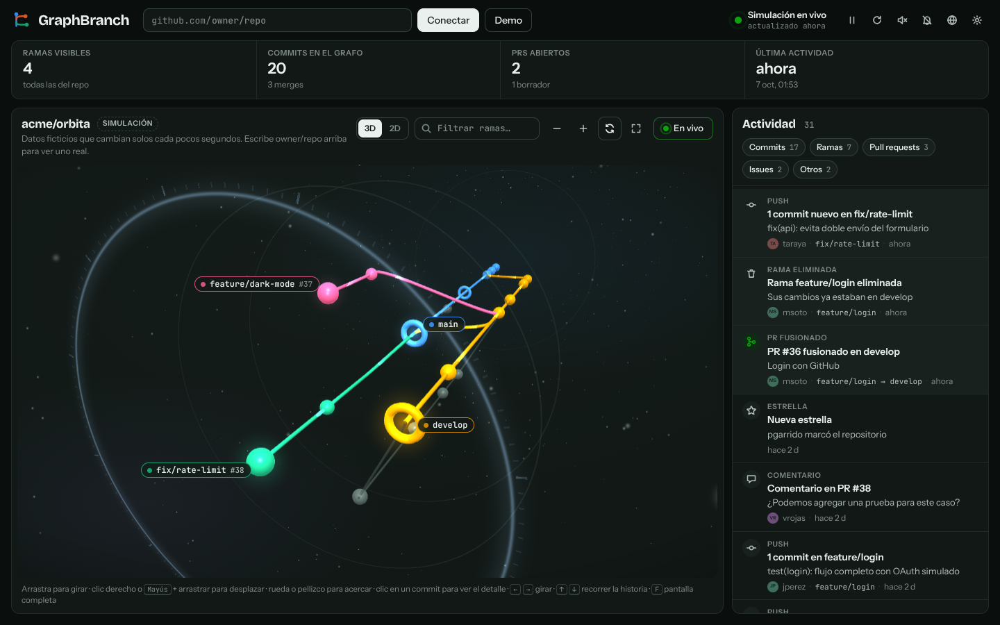

# GraphBranch

Grafo en vivo, en 3D o 2D, de las ramas de un repositorio de GitHub, de un proyecto de GitLab, de un repositorio de Codeberg o de Bitbucket, o de una carpeta de tu computadora, con alertas de toda su actividad: commits, force-push, ramas creadas y borradas, pull requests, revisiones, issues, releases, estrellas y forks.



- **Vista 3D**: la rama por defecto es el tronco central y las demás se reparten a su alrededor en espiral, las más activas más cerca del tronco; el tiempo avanza hacia ti, hasta el anillo del presente, y la historia se pierde en la niebla. Se mira de tres cuartos, con el pasado a la izquierda y el presente a la derecha, como en la vista 2D. Puedes girar, acercar y desplazarte con el ratón o el teclado; la cámara entra en escena con un vuelo desde el pasado, sigue lo último y, cuando no la tocas, se mece despacio de un lado al otro (sin terminar mirando la historia desde atrás). Pasar el puntero por el nombre de una rama (o llegar a él con el teclado) la **resalta entera**, como en la 2D: lo demás se funde con el fondo, y sigue resaltada mientras su detalle está abierto. **De cerca, cada commit dice su mensaje** a su lado (los más cercanos, sin pisarse), y las fechas del eje del tiempo ya no se pisan entre ellas ni con los nombres de las ramas.
- **Inmersiva**: cada commit nuevo llega volando desde el presente y se posa con una onda y chispas; las cabezas de rama laten con un halo, pulsos de luz recorren las ramas vivas hacia el presente, y polvo y estrellas derivan hacia el pasado.
- **Cada evento con su efecto**: un PR fusionado viaja como un cometa en arco desde su rama hasta la base; un PR abierto levanta un faro de luz sobre su rama; un release lanza fuegos artificiales; una estrella o un fork nuevos cruzan el cielo como estrella fugaz; una rama borrada se deshace en polvo; las aprobaciones, los cambios pedidos y los force-push hacen ondas de color sobre su rama. En la vista 2D pasa lo mismo sobre el plano: el cometa recorre la curva del merge desde la rama del PR hasta la base (o cruza en arco si fue un squash), el faro se levanta sobre la cabeza de la rama, los fuegos artificiales suben desde abajo y la etiqueta de una rama borrada se deshace en polvo. Cada tipo tiene un tope por tanda, así una ráfaga no satura la escena. Con **pantalla completa** (botón o tecla `F`) el grafo ocupa toda la pantalla y los avisos lo acompañan. Si el sistema pide reducir el movimiento, la escena queda quieta.
- **Modo vuelo**: el botón del avión te deja volar libre por el grafo en primera persona, como en una nave, con inercia: `W` `A` `S` `D` para moverte, `Q` `E` para inclinar la nave, `Espacio` `C` para subir y bajar, `Mayús` para acelerar, `X` para el escáner y el ratón para mirar (un clic bloquea el puntero y aparece una mira: el commit o el planeta que está en el centro muestra su detalle y un clic lo fija). La nave gira libre en los tres ejes: inclinada, el ratón mira respecto de ella, y una línea de horizonte junto a la mira muestra cuánto está ladeada. En el valle, al soltar `Q` `E` la nave vuelve sola a nivelarse con el horizonte; en el espacio se queda como la dejaste. La cámara se ladea un poco en las curvas, el campo de visión se abre a toda velocidad y, con el sonido activado, suena un motor que sube con la velocidad. En el celular aparecen un joystick, dos botones para inclinar la nave y uno de radar para escanear, y se mira arrastrando; con un mando de juego, los sticks mueven y miran, los gatillos bajan y suben, `LB` `RB` inclinan, `X` escanea y Start entra o sale del vuelo.
- **Modo galaxias**: el botón de la espiral convierte la vista 3D en un universo, al estilo de *No Man's Sky*. Cada rama es una galaxia: sus commits son las estrellas de un brazo en espiral, con la cabeza en el núcleo (cada push hace girar la galaxia un paso), las bifurcaciones y los merges son puentes de luz entre galaxias y los commits de las ramas ya fusionadas y borradas orbitan, como corrientes de estrellas, la galaxia donde se fusionaron. La rama por defecto está en el centro y las demás alrededor, repartidas por el espacio (arriba, abajo y a los lados, no en un plano) y con mucho aire entre ellas, cada una en su lugar mientras exista. Al acercarte, la galaxia se resuelve en estrellas y aparecen sus **planetas: los archivos**. Las líneas (los brazos y los puentes entre galaxias) se ven de lejos y se apagan al acercarte: dentro de una galaxia no tapan sus estrellas ni sus planetas, y vuelven de a poco al alejarte. Entrar en una es una **llegada**, como al salir de un salto en *No Man's Sky*: líneas de velocidad y un destello de su color, el cielo que cambia de golpe a ese color, un rótulo grande con su nombre que se decodifica letra a letra y sus datos (commits, planetas, asteroides, líneas cambiadas, última actividad), una onda de escáner que va revelando los planetas y, con el sonido activado, un acorde. La misma galaxia no se vuelve a anunciar antes de 40 segundos; cuando filma el director de cámara solo aparece el rótulo. Y una vez dentro se ve el **sistema entero**: los **mundos principales** (los ocho planetas más grandes) llevan un marcador en pantalla con su nombre, qué clase de mundo son (gigante gaseoso, mundo oceánico o rocoso) y a qué distancia están, visible desde cualquier punto del sistema; el rótulo de arriba a la izquierda se despliega en un **panel del sistema** con la lista de esos mundos (pasar el puntero por uno lo resalta y muestra su ficha; un clic lleva hasta él), que se abre solo al llegar y se pliega a los segundos (un clic en el rótulo lo abre o lo cierra); la ficha de cada planeta dice qué clase de mundo es y tiene un botón **Visitar**; y al entrar en una galaxia con doble clic o desde la lista de ramas, la cámara se acomoda en un **mirador** desde donde caben todas sus órbitas (si sus archivos llegan después, se reencuadra sola). En la rama por defecto son los del repo; en las demás, los que la rama cambió respecto de la rama por defecto (los nuevos con un halo verde, los borrados apagados y con halo rojo). Los archivos más grandes son planetas, en órbitas con aire entre ellos para pasar volando (cada carpeta ocupa un tramo, con su nombre), y los más chicos, asteroides que dan tumbos en un cinturón; todos giran más lentos cuanto más lejos. Al entrar en el sistema la nave frena para pasar entre los planetas con calma (`Mayús` sigue acelerando) y no puede atravesarlos. Cada planeta tiene su superficie según su archivo (océanos y continentes, bandas de gigante gaseoso o roca con cráteres), el color de su lenguaje, atmósfera, rotación propia y a veces anillos. Un clic en un planeta muestra su ruta, cuántas líneas cambiaron (o su tamaño) y un enlace al archivo en GitHub. El cielo es de nebulosas que se tiñen con el color de la galaxia en la que estás, a toda velocidad las estrellas pasan como estelas y el **escáner** (`X` en vuelo) lanza una onda que hace destellar los planetas que alcanza y revela sus nombres. En vuelo, la **mira fija lo que apunta**: un recuadro de esquinas se cierra sobre el planeta o la galaxia que tienes delante y dice qué es (su clase de mundo, o sus commits) y a qué distancia está. Y para ir lejos está el **hiperimpulsor** (`J` en vuelo, `Y` en el mando, el botón de la flecha en el celular, o **Saltar** en el detalle de una rama): apunta a una galaxia (o marca una como destino), la nave carga unos instantes girando hacia ella, cruza un túnel de luz de su color y sale al mirador de su sistema, con la llegada de siempre; con el sonido activado, la carga sube de tono y el salto suena a golpe de aire. Al rozar un planeta a toda velocidad el borde de la pantalla se enciende, como al entrar en su atmósfera, y con el sonido activado el espacio tiene un zumbido de fondo grave que cambia de nota con la galaxia en la que estás. Un rótulo arriba a la izquierda dice en qué galaxia estás y cuántos archivos tiene. El espacio usa siempre los colores del tema oscuro. La brújula y el minimapa del vuelo llevan a las galaxias, y entrar en una la descubre. Se recuerda en el navegador; al cambiar de modo, cada commit vuela a su lugar nuevo.
- **Mundo abierto**: el grafo no flota en el vacío: recorre el fondo de un valle, con su mapa pintado en el suelo como la sombra de cada rama. A los lados se abre una llanura con lomas y, en el horizonte, una cordillera con curvas de nivel, como en un mapa topográfico; arriba hay cielo con sol (luna y estrellas en el tema oscuro) y nubes que derivan con el viento. El mundo no tiene bordes y el suelo es sólido: la órbita no baja de él y en vuelo se lo puede rozar, no atravesar. En el **modo vuelo** aparece lo de un juego de mundo abierto: una **brújula** arriba con el presente, el pasado y cada rama (la más centrada dice su nombre y a cuántos metros está, y avisa si queda muy arriba o muy abajo), un **minimapa** que gira con la mirada y la altura y la velocidad. Cada rama se **descubre** al pasar cerca: un rótulo grande la anuncia con su motivo musical y el mapa se completa ("Mapa explorado: 3/12"); en la brújula y el minimapa las que faltan van huecas, y descubrirlas todas desbloquea el logro *Cartógrafo*. Para ir a una rama, **Marcar como destino** (en su detalle, o un clic en su marca de la brújula): una columna de luz la señala desde lejos, la brújula y el minimapa guían hasta ella y al llegar suena un aviso. Lo descubierto se recuerda por repositorio, solo en el navegador.
- **Recorrer la rama**: en el detalle de un commit o de una rama, **Recorrer la rama** lleva la cámara como una montaña rusa por toda la rama, desde el commit del que nace hasta su cabeza. Doble clic en un commit vuela hasta él.
- **Director de cámara**: el botón de la cámara de cine deja que la cámara se dirija sola, como en una transmisión. Elige qué mirar según el interés de lo que acaba de pasar (un release pesa más que un PR fusionado, que pesa más que un PR abierto, que pesa más que un commit), encuadra el arco entero de un merge o los fuegos de un release, sostiene cada plano unos segundos sin volver a la misma rama antes de 30 s (salvo por algo grande) y, cada tres planos de detalle, abre un plano general. Un rótulo abajo a la izquierda dice qué se está viendo. Los saltos largos son un corte con fundido y no un vuelo, para no marear; mientras dura un plano la cámara gira o se acerca despacio. Cuando no pasa nada rueda planos tranquilos: el presente, la vista general o un paseo por una rama. Basta mover la vista para tomar el control: el director lo cede al instante (el botón lo marca con un punto) y lo retoma tras unos segundos sin tocar nada. Con movimiento reducido solo hay cortes.
- **Modo TV**: el botón de la pantalla (o abrir la página con `?tv=1`, por ejemplo `index.html?repo=owner/repo&tv=1`) la convierte en un panel para una pantalla compartida: solo quedan el grafo 3D con el director de cámara, el resumen, el panel de actividad y un reloj, todo con letra que crece con la pantalla, y la pantalla no se apaga (Screen Wake Lock, donde el navegador lo permite). El sonido arranca apagado, porque en un espacio compartido llega a todos, y la capa de juego no hace fiestas. Una barra arriba a la derecha (se esconde con el puntero tras unos segundos quieto) tiene **Pausar** (también la barra espaciadora: detiene las novedades, la cámara y la animación de fondo), sonido, pantalla completa (`F`) y **Salir del modo TV** (también `Esc`). Si pasan unos minutos sin novedades, reproduce la historia con el Replay y vuelve sola al presente; cualquier actividad nueva la interrumpe. Con varios repos seguidos (`index.html?repo=owner/api&repo=owner/web&tv=1`) se ven sus pestañas, y la pantalla pasa sola al repo donde llega algo nuevo si el que muestra lleva 45 segundos sin novedades.
- **Widget embebible**: `?embed=1` deja solo el grafo y los avisos, sin barras, para un iframe en documentación, wikis o Notion; con `&bg=transparent` el fondo es transparente y con `&bg=00ff00` es de ese color (un croma, por ejemplo, en una fuente de navegador de OBS al transmitir mientras se programa); `&hide=notices,combo,legend,title,clock` quita de la capa los avisos emergentes, el contador de combos, la leyenda de ramas (2D), el rótulo de `&title=` y las fechas del eje del tiempo (3D); se piden los que se quieran, separados por comas (sin `hide`, se ve todo, como siempre); con varios `repo=` (`?embed=1&repo=a/b&repo=c/d&rotate=30`), `&rotate=30` pasa al siguiente repo cada tantos segundos (de 5 a 3600; sin `rotate`, no rota), para una escena de OBS que se cambia sola; `&theme=light` o `&theme=dark` fija el tema de la capa sin tocar el de la página que la contiene (sin `theme`, sigue al sistema); `&title=Directo de hoy` pone un rótulo propio sobre el grafo (hasta 60 letras, sin saltos de línea; sin `title`, no hay rótulo); `&max=5` muestra solo 5 ramas (la rama por defecto y las de commit más reciente; de 1 a 200, sin `max` se ven todas). Para pegar: `<iframe src="https://TU-SITIO/index.html?repo=owner/repo&embed=1" width="720" height="420" style="border:0" loading="lazy" title="GraphBranch"></iframe>`. Pensado para repos públicos: no sigue los repos guardados de la persona ni los toca, y no entra en modo TV.
- **Replay**: el botón de la flecha circular reproduce la historia del repo como un time-lapse, al estilo de Gource: los commits llegan en orden, las ramas nacen, crecen y se fusionan (las ya borradas reaparecen mientras existieron, con el nombre que dejó su merge), una fecha grande marca el tiempo y unos rótulos cuentan los hitos (ramas nuevas, PRs fusionados, releases), con sus efectos y su sonido. Los periodos sin actividad se comprimen, así que toda la historia dura menos de un minuto; la línea de tiempo marca los merges y las releases, se puede arrastrar, pausar (también con la barra espaciadora) y acelerar hasta 4×. Usa lo que ya está cargado, sin consultas extra: para una historia más larga, sube los **Commits por rama** en Ajustes. Mientras tanto lo nuevo sigue llegando al panel de actividad, y **Volver al presente** lo muestra. El botón del calendario de su barra abre **Tramo y rótulos**: un **Desde** y un **Hasta** (días, inclusivos) para reproducir y grabar solo un sprint o un lanzamiento (el estado anterior al tramo ya está dibujado al empezar, y la línea de tiempo cubre solo el tramo), y un **Título** y un **Pie de foto** propios que se ven sobre el grafo y quedan en el video. Un tramo sin commits avisa y deja el Replay como estaba; **Toda la historia** lo quita. Se recuerdan mientras la página siga abierta, y viajan en la URL para compartir un sprint ya listo: `index.html?repo=owner/repo&replay=2026-09-01..2026-09-14&title=Sprint%2012&footer=Lanzamiento` abre el repo y arranca el Replay con ese tramo y esos rótulos (cualquiera de las dos fechas puede faltar, `replay=1` es toda la historia).
- **Salud del repo**: el botón del pulso, en la barra superior, abre un panel con lo que ya está cargado (sin consultas nuevas, salvo la de los forks, que se hace al abrir el panel): las ramas sin actividad hace más de 30 días y sin pull request abierto, los pull requests abiertos del más viejo al más nuevo y, aparte, **por estado** (borrador, con los checks en rojo, aprobados y esperando revisión; cada fila salta a su rama), el tiempo de abierto a fusionado de los últimos 20 PRs fusionados (mediana y el más lento), el ritmo de merges (7 y 30 días) y releases (30 días), los PRs **fusionados** y los **abiertos por semana** de las últimas 8 (de la más vieja a la actual) y, con el vocabulario de DORA, la **entrega**: despliegues en 30 días (cada release cuenta como uno), la mediana entre los últimos 10 releases, los despliegues **por semana** de las últimas 8 (de la más vieja a la actual) y el tiempo de entrega (de abierto a fusionado; al abrir el panel, con token hasta 20 consultas y sin token 8, una por PR fusionado reciente, pide su primer commit y desde ahí cuenta, indicando de cuántos PRs lo supo). Más abajo, los **fallos de CI**: cuántos de los PRs abiertos con checks ya resueltos están en rojo (con el porcentaje) y cuántas veces la rama por defecto pasó a rojo en 30 días. Cada fila de las listas lleva a su rama en el grafo. Arriba van los **forks con actividad reciente** (push propio en los últimos 90 días, ordenados por actividad reciente —el push más nuevo primero—, hasta 30; cada fila abre el fork en GitHub; cada fila suma sus estrellas (★ n) y la casilla «Ordenar los forks por estrellas» los ordena por ellas, con el push más nuevo como desempate; el interruptor «Mostrar forks» los oculta y deja `forks=0` en la dirección, y con la dirección `?forks=0` el panel abre sin ellos y ni siquiera hace la consulta). Describe al repositorio, nunca a personas: no hay cifras por autor. El mismo panel tiene **Buscar choques**: al pulsarlo compara con la rama por defecto cada rama con un pull request abierto (hasta 20) y lista los archivos que tocan varias a la vez; cada fila lleva a una de esas ramas. La vista viaja en la URL: `?conflicts=1` abre el repo con el panel de salud abierto y los choques ya buscados (en cuanto llegan dos ramas con PR abierto), y buscarlos a mano deja `conflicts=1` en la dirección para compartirla; cerrar el panel lo quita. Y **Comparar dos ramas**: se eligen dos y dice cuántos commits lleva cada una por delante y desde qué commit se separaron (con lo ya cargado, sin consultas; cada línea lleva a la rama o al commit en el grafo; además el grafo, en 2D y en 3D, deja a la luz los commits de cada tramo —con un anillo continuo para la rama A y uno punteado para la B— y el punto de separación más grande, y atenúa el resto hasta pulsar «Quitar el resaltado del grafo»), y qué archivos cambió solo una, solo la otra o las dos (dos consultas, solo al pulsar «Comparar»). Y **Resumen de la semana**: los últimos 7 días con lo ya cargado (commits, pull requests fusionados, los pull requests abiertos en la semana —cada PR una vez, aunque se haya reabierto—, los issues cerrados en la semana —cada issue una vez, hasta 10 filas—, releases, los tags cuyo commit es de la semana —sin repetir los que ya salen como release—, cuántas personas aportaron por primera vez —con lo cargado—, quién aportó —hasta 5, por commits— y la rama más activa), para copiar como Markdown, guardar como `.md` o guardar como imagen `.png` para compartir (una tarjeta oscura de 1200 px con las mismas cifras, hasta 5 filas por lista); sin consultas. Con dos o más repos abiertos de una organización seguida (`org:nombre`), el panel suma el **resumen de la semana de la organización**: los totales y una sección por repo con actividad (hasta 20), también como Markdown o como imagen `.png` (los totales y hasta 8 repos), con lo ya cargado de cada pestaña. `?health=1` (por ejemplo `index.html?repo=owner/repo&health=1`) abre el panel apenas el repo tiene grafo, para compartir la vista; cerrar el panel lo quita de la dirección, y no se aplica dentro de un `?embed=1`.
- **Bitácora en vivo**: la quinta cifra del resumen, en el home, es la bitácora del repo, con la forma de las bitácoras de Brunell_Node: su número, su nota del 1 al 100 (si subió o bajó respecto de la anterior) y cuántos hallazgos tiene, todo recalculado con cada novedad. Al pulsarla se abre el panel: un encabezado con lo que pasó desde la bitácora anterior (o, la primera vez, en los últimos 7 días), y secciones numeradas: **lo grande** (el release, el PR que más commits trajo a la rama por defecto o la rama con más trabajo pendiente), **el período** (commits por día, separando los que ya llegaron a la rama por defecto, y una franja de cifras), el **veredicto** (la nota y de dónde sale cada punto: *ritmo*, días con commits de los de la ventana; *publicado*, qué parte de los commits ya está en la rama por defecto; y *salud*, 100 menos lo que resta cada hallazgo, 20 si es alto, 10 si es medio y 4 si es bajo; con la tabla de todas las bitácoras), los **hallazgos** (checks en rojo en la rama por defecto, PRs con checks en rojo o esperando revisión hace más de 7 días, force-push, ramas borradas sin fusionar, ramas olvidadas, veces que la rama por defecto se puso roja, una ventana sin commits; cada rama lleva al grafo), el **seguimiento** de los hallazgos de la anterior (arreglado, a medias, sigue o nuevo), la **cronología** día por día con su titular, **qué sigue** y las bitácoras anteriores. «Cerrar la bitácora» la guarda en este navegador, con un título propio si se escribe uno (si no, el de lo grande), y empieza la siguiente desde ese momento («Deshacer» la reabre); también se copia o se guarda en Markdown o como `estado.json` con el mismo esquema que las de Brunell_Node (corte, nota, historial, hallazgos con su estado y anteriores). `?bitacora=1` abre el panel al cargar. En la demo trae cuatro bitácoras anteriores ficticias, y lo que se cierra en ella no se guarda. Sin consultas: describe al repositorio, nunca a personas.
- **Prompt del loop autónomo**: el botón del infinito, en la barra superior (y «Prompt del loop autónomo» en la bitácora), arma un prompt para que Claude Code desarrolle un proyecto solo, una iteración por corrida, como el loop de Brunell_Node pero para cualquier repo. Trae el repo a la vista y su rama por defecto ya puestos; se elige la rama de integración, una rama de release que el loop nunca toca (opcional), el objetivo del proyecto (opcional) y el idioma del prompt (español o inglés), y se copia o se guarda como `.md`. El prompt es una semilla: la primera corrida estudia el repo y deja la maquinaria en él (`LOOP.md`: directiva, modos, puertas con los comandos reales, backlog con puntaje, pedidos al dueño y bitácora), y las siguientes la leen desde la rama de integración recién traída y la siguen (donde contradiga al prompt, manda `LOOP.md`). Cada iteración sincroniza, reclama su ítem con una rama en el remoto (dos sesiones no hacen lo mismo), elige el modo por el número de iteración (construir, QA, diseño, mercado, meta, robustez), prueba de verdad (línea base, una prueba que falla sin el cambio, mutación, todas las puertas, en vivo y revisión adversarial si hay riesgo), publica con PR solo lo verificado, registra y reporta; con presupuesto de regresiones, guarda contra el trabajo circular y una lista de lo que nunca hace. Lo escrito se recuerda por repo en este navegador (en la demo, no).
- **Vista de texto**: el botón de las líneas, en la barra superior, abre las ramas y sus últimos 10 commits como un árbol (`role="tree"`) que se recorre solo con el teclado y que lee un lector de pantalla: la rama por defecto primero y luego las más movidas, cada nodo con su nombre completo (mensaje, autor, hace cuánto, si es un merge y sus tags, dichos como «tag v1.0.0»; al abrir, la región viva cuenta cuántos commits con tag hay; si el feed del repo trae un release (`ReleaseEvent`) cuyo tag está en un commit, ese commit lo dice como «release v1.4.0» en su nombre y la región viva cuenta cuántos commits llevan release). ↑ ↓ recorren lo visible, → abre una rama o baja a su primer commit, ← la cierra o sube a ella, Inicio y Fin saltan a los extremos y Enter lleva al grafo (2D o 3D) hasta esa rama o ese commit. Un campo «Filtrar ramas…» deja las ramas cuyo nombre contiene el texto (↓ pasa al árbol). Si hay un filtro por autor o por ruta en el grafo, el árbol lo respeta (solo las ramas de esa persona; solo los commits que tocaron la ruta) y una nota lo dice, y la región viva lo anuncia al abrir. Con **`?vista=texto`** (o **`?view=text`**) en la dirección abre ya la vista de texto, con `?path=` aplicado (espera a que llegue el filtro por ruta) y `?q=` escrito en «Filtrar ramas…», y la región viva anuncia ruta y ramas mostradas (no abre además la búsqueda). Debajo del árbol, si ya hay forks activos cargados (los del panel de salud), una lista aparte de hasta 10 enlaces —el push más reciente primero, cada uno dicho como «nombre, último push hace…»— abre cada fork en GitHub, y la región viva cuenta «Forks activos: n» al abrir; `?forks=0` y el interruptor «Mostrar forks» apagado la quitan. Mientras está abierta una región viva (`role="status"`, educada) anuncia «Novedades: n ramas, m commits» solo de lo que aún no se había leído, sin perder el foco ni las ramas abiertas. No hace ninguna consulta: parte de lo que ya está cargado.
- **Búsqueda de commits**: la lupa, en la barra superior, busca entre los commits ya cargados por mensaje, SHA (entero o parte) o autor (`@ana`, por nombre o por usuario); todas las palabras tienen que aparecer, y `desde:2026-09-01` / `hasta:2026-09-14` acotan por fecha (días en UTC, ambos incluidos; una fecha que no existe se busca como texto). Un selector filtra por autor ("mis commits") con la cuenta de cada uno, y Enter, o un clic, vuela en el grafo (2D o 3D) hasta el commit. No hace ninguna consulta, así que no gasta cuota de GitHub, y funciona en la demo. Debajo, un campo de **ruta** (archivo o carpeta, p. ej. `src/`): «Filtrar grafo» deja a plena luz los commits que la tocaron y atenúa el resto del grafo, en 2D y en 3D (allí, esferas más chicas y casi sin halo); y viaja en la URL: `?path=src/` abre el repo ya filtrado (el campo de ruta y la dirección se mantienen al día mientras haya filtro); «Quitar filtro» lo deshace. Y **«Mostrar solo las ramas de…»** deja en el grafo (2D y 3D) y en la vista de texto solo la rama por defecto y las ramas con commits de esa persona (los que no están ya en la rama por defecto): «mis ramas». Funciona con las cinco fuentes, no hace ninguna consulta, se recuerda por repo y viaja en la URL: `?author=ana` (el usuario o el nombre tal como sale en el selector) abre el repo a la vista ya filtrado, sobre lo recordado, y la dirección sigue al selector. El texto de la búsqueda viaja igual: `?q=texto` abre el repo con la lupa ya abierta y escrita (con sus resultados), y la dirección sigue al campo; la lupa se subraya mientras hay un filtro activo.
- **Cambios de cada commit**: en el detalle de un commit, **Ver cambios** abre a la derecha del grafo (en el celular, debajo) los archivos que cambió frente a su primer padre: la lista, con lo agregado y lo quitado de cada uno, y el diff de cada archivo con sus números de línea, las líneas agregadas en verde y las quitadas en rojo. Se pasa de un commit a otro sin cerrarlo: `←` o `J` va al anterior y `→` o `K` al siguiente de la misma rama (y vuelve por el mismo camino si se bifurcó); el grafo acompaña cada paso y marca el commit que se está viendo. Lo que ya se vio queda guardado y, cuando no gasta una cuota escasa (con token, en GitLab, Codeberg, la demo y las carpetas locales), los commits vecinos se piden por adelantado: el paso siguiente es inmediato. Funciona con GitHub, GitLab, Codeberg, Bitbucket, las carpetas de tu computadora y la demo.
- **Logros, nivel y misión del día**: el repo sube de nivel con lo que el equipo consigue (merges, revisiones aprobadas, releases, issues cerrados, ramas fusionadas que se limpian; un commit suma poco), cumple una misión distinta cada día ("Fusionar 3 pull requests", "Cerrar 2 issues"…) y desbloquea 15 logros, como *Primer merge*, *Día de merges*, *¡A producción!*, *Bandeja vacía*, *Día récord*, *Bosque*, *Viajero del tiempo* o *Cartógrafo*. Cada logro, nivel o misión se celebra con un aviso dorado, fuegos artificiales y fanfarria, y cuando el equipo encadena varias cosas seguidas aparece un **combo**. El trofeo de la barra superior abre la vitrina, con el criterio de cada logro y un interruptor para apagar todo. Celebra al repo y al equipo, nunca a personas: no hay rankings, rachas personales ni contadores por autor, porque empujan a trabajar de más (GitHub quitó sus rachas en 2016 por eso). Se guarda solo en el navegador, por repositorio.
- **Vista 2D tipo metro**: cada rama es un carril; los commits avanzan a la derecha. La rama por defecto va arriba, debajo las fijadas y luego las demás, de la más reciente a la menos activa. Cambia entre 3D y 2D con el selector del grafo. Abajo, un **minimapa** muestra el grafo entero en miniatura con la ventana de lo que se ve: un clic lleva hasta ese punto y la ventana se arrastra (en el Replay lo reemplaza su propia línea de tiempo). Las ramas ya fusionadas y borradas llevan su **nombre** sobre su tramo gris (sale del mensaje de su merge) y pasar el puntero por un commit resalta toda su rama. Se recorre también con el **teclado**: flechas, `Re Pág` `Av Pág`, `Inicio` `Fin` y `+` `-`.
- **Colores**: toda rama viva tiene un color propio, de una paleta de más de 8.000: los 8 primeros están elegidos a mano y el resto se genera repartido lo más lejos posible entre sí, en el tema claro y en el oscuro, así que cada rama nueva toma un color distinto sin importar cuántas haya. La rama por defecto lleva siempre el primero, cada una conserva el suyo mientras exista y la que se borra lo deja libre. El gris es solo de las ramas muertas: las ya fusionadas y borradas, y las ya fusionadas que siguen existiendo (su cabeza ya está en la rama por defecto). Las ramas de larga vida (`develop`, `release/…`, protegidas) y las recién creadas sobre la cabeza de la rama por defecto no se dan por muertas; una rama fusionada que recibe commits nuevos vuelve a tener color.
- En ambas, las bifurcaciones y merges se dibujan como curvas y las ramas muertas quedan en gris.
- **En vivo**: los commits nuevos aparecen con una onda, la etiqueta de la rama se desliza hasta su nueva cabeza, la rama sube justo bajo la rama por defecto (los carriles se reordenan según su última actividad) y la vista sigue lo último (o te deja recorrer la historia).
- **Guardar imagen**: el botón de la cámara de fotos guarda la vista como un PNG tal como se ve en ese momento, en 3D o en 2D, en cualquier modo (galaxias, vuelo, Replay), con las etiquetas de las ramas y los efectos en curso, y abajo una franja con el repo y la fecha, lista para compartir. La 2D sale al doble de resolución; la 3D, a la resolución con que se dibuja. Se descarga como cualquier archivo (`graphbranch-owner-repo-2026-10-10-1430.png`); en la app de escritorio va directo a la carpeta de descargas.
- **Grabar el Replay en video**: en la barra del Replay, el botón del punto rojo graba la historia del repo desde el principio hasta el final, tal como se ve, con la fecha grande, los rótulos de los hitos y abajo la franja con el repo: un video para una presentación, un mensaje o una red social. Mientras graba el punto late en rojo y se puede pausar o cambiar la velocidad (a 4×, la historia entera dura unos 11 segundos). Al llegar al final el video se guarda solo; tocar el botón otra vez o **Volver al presente** lo termina antes y guarda lo grabado. Sale en WebM (MP4 en Safari) y se descarga como `graphbranch-owner-repo-replay-2026-10-12-0830.webm`; en la app de escritorio va directo a la carpeta de descargas.
- **Alertas**: panel de actividad filtrable, avisos emergentes, sonido opcional, notificaciones del sistema cuando la pestaña está en segundo plano y contador en el título de la pestaña.
- **También Codeberg** (Forgejo): los repositorios de codeberg.org, públicos o (con token) privados. Se pega su URL (también la de una rama o un archivo) o se escribe `codeberg:dueño/repo`, y se ven como uno de GitHub: ramas, commits y pull requests en vivo, sus efectos y su sonido, galaxias con el árbol de archivos y el Replay. Se siguen junto a los demás, cada uno en su pestaña (`?repo=codeberg:dueño/repo`). Sin token solo se leen repos públicos; con un token de acceso de Codeberg (permiso `read:repository`) en Ajustes se ven también los privados. Otros servidores de Gitea o Forgejo todavía no.
- **Extensión de VS Code** (`vscode/`): el comando «GraphBranch: Abrir el grafo de ramas» abre la app en un panel junto al editor, con el repo del `origin` del espacio de trabajo (GitHub, GitLab, Codeberg o Bitbucket) y la sesión de GitHub que VS Code ya tiene, sin pegar un token. Ver [Extensión de VS Code](#extensión-de-vs-code).
- **También Bitbucket Cloud**: los repositorios de bitbucket.org, públicos o (con token) privados. Se pega su URL (también la de una rama o un archivo) o se escribe `bitbucket:espacio/repo`, y se ven como uno de GitHub: ramas, commits y pull requests en vivo, sus efectos y su sonido, galaxias con el árbol de archivos y el Replay. Cada uno en su pestaña (`?repo=bitbucket:espacio/repo`). Sin token solo se leen repos públicos; con un token de acceso de repositorio o de espacio de trabajo (permiso `repository`) en Ajustes se ven también los privados. Bitbucket deja unas 60 consultas por hora por IP, así que los ciclos van más espaciados (ver Límites conocidos).
- **También GitLab**: los proyectos de gitlab.com, con sus subgrupos, públicos y también privados. Se pega su URL (también la de una rama o un archivo) o se escribe `gitlab:grupo/proyecto`, y se ven igual que un repo de GitHub, con todo lo de arriba: ramas, commits y merge requests en vivo (en las etiquetas, `!12` como en GitLab), issues, comentarios y tags en el panel de actividad, sus efectos y su sonido, galaxias con sus archivos y el Replay. Se siguen junto a los repos de GitHub, cada uno en su pestaña, y la URL los comparte igual (`?repo=gitlab:grupo/proyecto`). Los públicos no necesitan token; para los privados, un **Token de GitLab** en Ajustes (ver [Token](#token)).
- **Avisos a Slack, Discord y Teams** (solo en la app de escritorio): en Ajustes, una URL de webhook por servicio y los eventos que recibe cada una: releases, merges a la rama por defecto (un PR fusionado o un commit de merge), CI que pasa a rojo y force-push en la rama por defecto. Cada aviso lleva el repo, el tipo, el título, el detalle y el enlace, en el idioma de la página (en Teams, una tarjeta adaptable para el webhook de un flujo de Workflows o el conector heredado de Office 365); el botón **Enviar prueba** comprueba la URL. Solo avisa de lo que pasa en vivo mientras la app está abierta, en repos reales (no en la demo), y nunca de la primera carga.
- **Aprender git**: el botón **Practicar git** abre un repo de práctica con una terminal debajo del grafo. Se escriben comandos (`commit -m "…"`, `branch`, `checkout`, `switch` (`-c` crea; `--detach` va a un commit; un commit a secas da error, como en git), `restore <archivo>`/`restore .` (tira los cambios sin commit que dejó `touch`), `merge` (`--no-ff`, `--ff-only`, y `--no-commit` para dejar la fusión a medias hasta un `commit` o un `merge --abort`), `rebase` (`-i` se detiene tras el primer commit hasta un `rebase --continue`; `rebase --abort` deja la rama como estaba), `reset`, `cherry-pick` (`--no-commit` lo deja a medias hasta un `commit` o un `cherry-pick --continue`; `--abort` lo cancela), `revert` (`--no-commit` lo deja a medias hasta un `commit` o un `revert --continue`; `revert --abort` lo cancela), `stash` (`list`, `pop`, `apply`, `drop`), `tag` (`-d` borra; el `log` las muestra como `tag: v1`), `log`, `status`, `help`, y `touch <archivo>` para dejar cambios sin commit; el `git` delante es opcional) y el grafo 2D o 3D, el panel de actividad y las cifras responden al instante. Nueve ejercicios guiados (rama y commits, fusionar, rebase, deshacer con `reset`, copiar un arreglo con `cherry-pick` y etiquetarlo, deshacer un commit ya compartido con `revert`, apartar cambios a medias con `stash` para arreglar otra rama, probar una fusión con `--no-commit` y cancelarla con `merge --abort`, borrar una etiqueta de más con `tag -d` y cancelar un `cherry-pick` a medias) se dan por resueltos solos y se recuerdan en este navegador. Quien enseña puede **crear un ejercicio propio** (título, meta, comandos de partida, pistas opcionales y condiciones de resuelto) en «Crear un ejercicio para compartir» y copiar su enlace (`?practice=<código>`; `?practice=1` a `9` abre uno de la lista): el ejercicio viaja entero en la URL, sin servidor, y quien la abre cae directo en la práctica. Quien enseña puede añadir una **solución propuesta** (hasta 10 comandos, que se prueban al crear el ejercicio: tiene que resolverlo) y copiar el **enlace con la solución** (`?practice=<código>&solution=1`): al abrirlo aparece el botón «Ver solución», que escribe un paso por pulsación en la terminal sin ejecutarlo; el enlace común no lleva la solución en el código. Si trae **pistas** (hasta 3), aparece un botón «Pista» que las muestra de una en una; las condiciones pueden mirar el mensaje del último commit de una rama y si una rama tiene commits sin fusionar en otra. Con un repo real a la vista, **Ensayar un comando** abre una copia en memoria de sus ramas y commits ya cargados, con la misma terminal: se prueba un `merge` o un `rebase` sobre las ramas de verdad y el grafo muestra el resultado, sin escribir nada en el repo ni gastar consultas a la API; al volver a la pestaña del repo, el ensayo se cierra. Funciona sin token ni red, en la web y en la app de escritorio.
- **Tags y despliegues**: los tags se ven como un banderín sobre su commit en 2D y como un obelisco en 3D, y el commit que corre cada entorno de despliegue (producción, staging) lleva una placa con su nombre (plaquita en 2D, losa verde en 3D). La ficha del commit los nombra. Salen de `/tags` y `/deployments` de GitHub: dos consultas más al abrir el repo y dos cada 15 minutos (con ETag). Se apaga en Ajustes («Mostrar tags y entornos de despliegue») y la demo los trae.
- **GitHub Enterprise Server**: con `?api=https://host/api/v3` (o `--api-url=` en la app de escritorio) los repos de GitHub salen de tu servidor en vez de github.com: REST en esa dirección, GraphQL en `https://host/api/graphql` y los enlaces a `https://host`. Solo https. En la web, el host tiene que estar en el CSP (ver [Seguridad](#seguridad)); la app de escritorio lo suma sola, y solo ese host.
- **GitLab propio**: con `?gitlab=https://gitlab.miempresa.com` (o `--gitlab-url=` en la app de escritorio) los proyectos de GitLab salen de tu instancia en vez de gitlab.com: API v4 en `https://host/api/v4` y los enlaces a `https://host` (también con ruta, `https://host/gitlab`). Los proyectos se escriben como `gitlab:grupo/proyecto` o pegando su URL (`https://host/grupo/proyecto`, también `git@host:grupo/proyecto.git`). Solo https. En la web, el host tiene que estar en el CSP (ver [Seguridad](#seguridad)); la app de escritorio lo suma sola, y solo ese host.
- **Forgejo y Gitea propios**: con `?forge=https://git.miempresa.com` (o `--forge-url=` en la app de escritorio) puedes seguir repos de tu servidor de Forgejo o Gitea, además de los de codeberg.org: API v1 en `https://host/api/v1` y los enlaces a `https://host` (también con ruta). Los repos se escriben como `forgejo:dueño/repo` o pegando su URL (`https://host/dueño/repo`, también `git@host:dueño/repo.git`) y llevan la etiqueta *Forgejo*. Solo https y solo repos públicos, sin token. En la web, el host tiene que estar en el CSP (ver [Seguridad](#seguridad)); la app de escritorio lo suma sola, y solo ese host.
- **Bitbucket Data Center o Server propio**: con `?bitbucket=https://git.miempresa.com` (o `--bitbucket-url=` en la app de escritorio) puedes seguir repos de tu Bitbucket Data Center/Server por su API REST 1.0 en `https://host/rest/api/1.0` (también con ruta). Los repos se escriben como `bitbucketdc:CLAVE/repo` (`bitbucketdc:~usuario/repo` si es personal) o pegando su URL (`https://host/projects/CLAVE/repos/repo/browse`, `…/users/usuario/repos/repo` o `…/scm/clave/repo.git`) y llevan la etiqueta *Bitbucket*. Ramas, historia, pull requests, galaxias y los cambios de un commit. Como la mayoría de los servidores no deja leer sin iniciar sesión, Ajustes muestra (solo con un servidor elegido) el campo **Token de tu Bitbucket propio**: un token de acceso personal o HTTP con permiso de lectura, que va como `Authorization: Bearer …` solo a ese servidor y se guarda aparte de los demás, atado a su dirección (en la app de escritorio, cifrado con el llavero): con otro `?bitbucket=` no se usa ni se muestra. Con token, un 401 se dice como token rechazado y un 404 como repo no encontrado o sin permiso. Solo https. En la web, el host tiene que estar en el CSP (ver [Seguridad](#seguridad)); la app de escritorio lo suma sola, y solo ese host.
- **Repos de tu computadora** (app de escritorio): el botón **Abrir carpeta…** (junto a **Demo**) elige, con el diálogo del sistema, una carpeta con un repositorio git, y GraphBranch lo sigue como a cualquier otro, en su pestaña con la etiqueta *local*: ramas, commits, el panel de actividad (ramas nuevas, commits, merges, force-push, ramas borradas), galaxias con sus archivos y el Replay. Sin GitHub ni cuota ni conexión, también para repos privados, de cualquier servidor y con las ramas que nunca publicaste. Cada commit se ve al instante: la app vigila `.git`. Necesita `git` instalado. También se abre desde la línea de comandos con `npm start -- --local=/ruta/al/repo` (repetido, varios). Ver [Aplicación de escritorio](#aplicación-de-escritorio).
- **Varios repos a la vez**: cada repo que conectas se suma a los que ya sigues, en una pestaña bajo la barra superior. Todos se siguen en vivo aunque no estén a la vista: sus novedades llegan al panel de actividad (que junta las de todos y dice de qué repo es cada una), a los avisos, al sonido y a las notificaciones, y cada pestaña muestra su estado y cuántas novedades llegaron sin verla. Un clic en la pestaña, o en una actividad de ese repo, lo muestra al momento, sin volver a cargarlo; la **×** deja de seguirlo. Se recuerdan entre visitas, y la URL los lleva todos (`?repo=owner/api&repo=owner/web`), así se comparte el conjunto. Hasta 10 repos.
- **Una organización o un usuario entero**: escribe `org:nombre` o `@usuario` (o pega la URL de su perfil, `github.com/nombre`) y GraphBranch sigue sus repos con push más reciente, sin forks ni archivados, cada uno en su pestaña y hasta llenar las 10, y muestra el último que recibió un push. Un aviso dice cuáles sumó. La organización queda seguida: cada 30 minutos se renueva su lista y los repos nuevos se suman solos, y el panel de actividad suma los eventos de toda la organización (también los de repos que no caben en pestañas). También desde la URL: `?repo=org:nombre`.
- **Un grupo de GitLab entero**: escribe `group:ruta` (con subgrupos, `group:gitlab-org/ci-cd`) o pega la URL del grupo (`gitlab.com/groups/ruta`) y GraphBranch sigue sus proyectos de actividad más reciente, con los de sus subgrupos y sin forks ni archivados, cada uno en su pestaña y hasta llenar las 10. También desde la URL: `?repo=group:ruta`.
- **Sonido**: cada tipo de evento tiene su timbre (pulsación para los commits, campana para los PRs, acorde para los merges, arpegio para los releases) y todo suena en una escala pentatónica, a un pulso tranquilo: varios eventos juntos forman una frase. La rama por defecto es la tónica y cada rama tiene su nota; en 3D el sonido sale del lado de la pantalla donde está la rama. Viene apagado; se activa con el altavoz de la barra superior.
- **Estado en cada rama**: número de PR abierto, directamente en la etiqueta.
- **CI en el grafo**: junto al número de PR, una marca con el estado de los checks de la cabeza de la rama (✓ pasaron, ✗ fallaron, ● en curso), también en su detalle; los PRs llevan el de su último commit. Cuando la rama por defecto se pone en rojo, el panel de actividad lo avisa una sola vez (como «CI fallido»). La demo simula checks.
- **PRs apilados**: si un PR tiene por base la rama de otro PR abierto (una pila: A → main, B → A, C → B), la rama de B queda justo debajo de la de A y la de C debajo de la de B, y el detalle de cada una dice «Apilada sobre el PR #N». La demo trae una pila. Solo cuenta con PRs del mismo repositorio.
- **Todas las ramas**: se ven todas las ramas del repo, sin tope, también con miles: aparecen de a poco, las más activas primero, y el grafo sigue fluido (ver más abajo).

- **Instalable y sin conexión**: la versión web se instala como una app más, en el celular o en el escritorio, sin Electron: con su ícono, en su propia ventana y sin la barra del navegador (en Chrome y Edge, el botón de instalar de la barra de direcciones; en el iPhone, **Compartir → Agregar a inicio**). Después de la primera visita abre aunque no haya red: la demo funciona entera y los repos de GitHub dicen que esperan la conexión, y siguen solos en cuanto vuelve. Con red siempre carga la última versión.
- **Todos los idiomas**: la interfaz está traducida a 40 idiomas (incluidos árabe, hebreo, persa y urdu, de derecha a izquierda), se elige sola según el navegador y se puede cambiar en vivo desde el globo de la barra superior. Fechas, números y "hace 5 min" salen de `Intl`, así que también se ven bien en idiomas sin traducción (ver [Idiomas](#idiomas)).

No necesita servidor ni compilación: es HTML, CSS y JavaScript que llama directo a `api.github.com` (o a `gitlab.com`, `codeberg.org` o `api.bitbucket.org`) desde tu navegador. Las librerías (d3 y Three.js) y las fuentes van incluidas en `vendor/`, así que solo sale a internet para hablar con GitHub. La vista 3D usa WebGL; si el navegador no lo tiene, la app abre la 2D. También corre como [aplicación de escritorio](#aplicación-de-escritorio) con Electron.

## Uso

1. Abre `index.html` (doble clic sirve), publícalo con GitHub Pages (y desde ahí, instálalo) o usa la [aplicación de escritorio](#aplicación-de-escritorio) (abajo).
2. Escribe `owner/repo` o pega la URL del repositorio (de GitHub, de un proyecto de gitlab.com, de un repo de codeberg.org o de uno de bitbucket.org) y pulsa **Conectar**. Sin repositorio arranca una **demo** simulada. Para seguir otro repo a la vez, conéctalo igual: se suma en una pestaña y el anterior sigue en vivo detrás (ver [Varios repos a la vez](#varios-repos-a-la-vez)). Para los repos más activos de una organización o de un usuario de GitHub, escribe `org:nombre` o `@usuario`.
3. Opcional pero recomendado: en **Ajustes** (engranaje) agrega un token de GitHub.

También puedes abrir un repo directo con `index.html?repo=owner/repo`, varios con `index.html?repo=owner/api&repo=owner/web` (el primero queda a la vista), los de una organización con `index.html?repo=org:nombre` en modo TV con `index.html?repo=owner/repo&tv=1` y con el panel de salud abierto con `index.html?repo=owner/repo&health=1`.

### Token

Sin token GitHub permite 60 consultas por hora, así que la vista se actualiza cada pocos minutos y las ramas llegan de a poco. Con un token se actualiza cada 10 segundos, ves repos privados y todas las ramas cargan en segundos, aunque sean miles. La cuota es una sola para todos los repos que sigues: sin token, seguir varios los vuelve más lentos todavía, así que con más de uno conviene el token.

Crea un token *fine-grained* de solo lectura en <https://github.com/settings/personal-access-tokens/new> con acceso al repositorio y estos permisos (todos *Read-only*): **Metadata** (incluye la actividad del repo: pushes y ramas creadas o borradas), **Contents** y **Pull requests**.

El token se guarda solo en el `localStorage` de tu navegador (en `<usuario>.github.io`, que comparten todos los proyectos del usuario, en el `sessionStorage` de la pestaña: hay que ponerlo de nuevo al cerrarla; en la app de escritorio, cifrado con el llavero del sistema) y se envía únicamente a `api.github.com`.

**GitLab** tiene su propio campo en Ajustes, **Token de GitLab**. Solo hace falta para proyectos privados de gitlab.com: crea un token de acceso personal en <https://gitlab.com/-/user_settings/personal_access_tokens> con el permiso **read_api** (solo lectura) y la fecha de vencimiento que prefieras. Se guarda igual que el de GitHub, aparte de él, y se envía únicamente a `gitlab.com`. Si un proyecto no aparece, la página lo dice y ofrece abrir Ajustes con el foco en ese campo; si el token no vale, venció o no tiene **read_api**, también lo dice. Al guardar, solo se reconectan los repos del servicio cuyo token cambió.

### Ciclo de actualización

GraphBranch consulta GitHub en ciclos: cada 10 segundos con token y cada minuto sin él, o más espaciado si la cuota no alcanza hasta su próximo reinicio (el indicador dice **En vivo, más lento**; con token cuida la cuota de GraphQL y también la de REST). El indicador de la barra superior cuenta qué pasa: "actualizando…" mientras dura un ciclo y "próxima en 10 s" entre uno y otro. El ciclo se cuida solo:

- Si una consulta no llega entera en 30 segundos se corta y se reintenta, así una conexión colgada no deja la vista congelada.
- Tras un error los reintentos se espacian (5 s, 10 s, 20 s… hasta 5 minutos, con algo de azar para que muchas pantallas no reintenten a la vez). Si GitHub pide esperar (cuota agotada, o límite secundario: lo que diga `Retry-After`, o un minuto si no lo dice), espera justo eso y no lo cuenta como fallo.
- Sin red no insiste: espera a que el navegador avise que volvió la conexión ("esperando la conexión") y consulta enseguida.
- Al volver a la pestaña, o cuando el navegador la descongela, si ya tocaba consultar lo hace al momento (en segundo plano los navegadores frenan los temporizadores; igual sigue consultando, para poder avisar).
- **Actualizar ahora**, cambiar el filtro o fijar una rama adelantan el ciclo del repo a la vista (si hay uno en curso, el siguiente va enseguida); **Pausar** detiene los de todos los repos seguidos, y al dejar de seguir uno se cortan sus consultas en curso.
- Con varios repos seguidos, cada uno tiene su ciclo y cuenta con que los demás gastan lo mismo que él: así entre todos no agotan la cuota (cuantos más repos, más espaciado, si la cuota no da para todos cada 10 segundos). Al abrir la página arrancan escalonados, no todos en el mismo instante.

## Varios repos a la vez

Cada repo que conectas se suma a los que ya sigues. Con más de uno aparece una fila de pestañas bajo la barra superior:

- **Todos en vivo**: cada repo tiene su propia conexión con GitHub y sigue consultando aunque no esté a la vista. Lo que pasa en cualquiera llega al panel de actividad, a los avisos emergentes, al sonido y a las notificaciones del sistema, con el nombre del repo.
- **Pestañas**: cada una muestra el estado de su repo (el mismo punto de color del indicador de la barra: en vivo, más lento, sin conexión, cargando) y cuántas novedades llegaron mientras no estaba a la vista. Un clic la muestra al momento: el repo ya está cargado, así que no se vuelve a pedir a GitHub. La **×** deja de seguirlo (y se lleva su actividad del panel).
- **Panel de actividad**: junta la actividad de todos los repos, la más reciente primero (hasta 300 elementos por repo). Un clic en una actividad de otro repo lo muestra y va hasta esa rama o commit.
- **Lo que es de cada repo**: el grafo, el resumen, el Replay, las ramas fijadas, el filtro, las ramas descubiertas en el modo vuelo y los logros. Los logros de los repos que no están a la vista suman igual, sin festejo; la vitrina muestra los del repo a la vista.
- **Conectar** un repo que ya sigues lo muestra (y, si quedó sin conexión, lo vuelve a intentar). **Demo** muestra la demo sin dejar de seguir tus repos; la demo se cierra al volver a uno de ellos.
- **Se recuerdan**: al volver a abrir la página siguen los mismos repos y se muestra el último que mirabas. La URL los lleva todos (`?repo=owner/api&repo=owner/web`, el primero a la vista), así que se puede compartir o dejar abierta en una pantalla; los repos de una URL se suman a los que ya seguías.
- **La cuota se reparte**: los ciclos de cada repo se espacian para que entre todos no agoten la cuota de GitHub (ver [Ciclo de actualización](#ciclo-de-actualización)). Sin token la cuota es de 60 consultas por hora para todos juntos, así que para seguir varios conviene un token.
- Se pueden seguir hasta 10 repos a la vez.
- **Una organización o un usuario entero**: `org:nombre`, `user:nombre` o `@nombre` (también la URL de su perfil, `github.com/nombre` o `github.com/orgs/nombre`) piden a GitHub la lista de sus repos, los de push más reciente primero, y siguen los que entren hasta llegar a 10 pestañas, sin forks ni archivados ni los que ya seguías. Se muestra el de push más reciente y un aviso nombra los que se sumaron (y si quedaron otros fuera por el tope). La lista cuesta una consulta para una organización y dos para un usuario (primero se pregunta como organización). Con token, una organización trae también sus repos privados que el token puede ver. Desde la URL, `?repo=org:nombre` hace lo mismo al abrir; lo que se guarda y se comparte después son los repos, uno por uno.

La organización o el usuario queda además **seguido** (se guarda en este navegador, con los nombres de repos que ya vio su lista): cada 30 minutos, con la pestaña a la vista y sin pausa, GraphBranch vuelve a pedir la lista y suma los repos que no había visto, hasta el tope de 10 pestañas, con un aviso que los nombra. Un repo que cierras no regresa, y al cerrar el último repo de una organización deja de seguirse. Una renovación cuesta una consulta por organización (dos por usuario).

Los **eventos de la organización** (`/orgs/{org}/events`, una consulta para todos sus repos) se piden cada 5 minutos con ETag (un 304 no gasta cuota con token) y llegan al panel con el nombre de su repo, solo los de repos que no tienen pestaña propia: los demás ya los trae su pestaña. Un usuario no tiene eventos de organización.

## Repositorios con miles de ramas

GraphBranch muestra todas las ramas, pero no las vuelve a pedir todas en cada ciclo (con 10.000 ramas serían 100 consultas cada vez). Según lo que tenga disponible, usa uno de tres modos:

| Modo | Cuándo | Cómo detecta el movimiento |
|---|---|---|
| **GraphQL** | Con token | Lista todas las ramas de a 100 por consulta: en cada ciclo si caben en una, y si no al cargar y cada unos minutos (más espaciado cuantas más páginas). Entre medio, la API de actividad del repo dice qué ramas recibieron pushes, se crearon o se borraron, casi al instante (una consulta con ETag: si no hubo cambios no gasta cuota), y solo esas se consultan, junto con los PRs abiertos y las ramas fijadas, en una consulta GraphQL por ciclo. Cuesta ~1 punto de los 5.000/hora. Si el token no puede leer la actividad, usa el feed de eventos, que llega con unos minutos de retraso, y mira en cada ciclo las 50 ramas más activas. |
| **Lista** | Sin token y hasta 100 ramas | Lista las ramas por REST con ETag y compara. La historia de cada rama cuesta una consulta, así que llegan de a 12 por ciclo, cuidando la cuota. |
| **Eventos** | Sin token y más de 100 ramas | Sigue el feed de eventos del repo (pushes, ramas creadas y borradas). GitHub lo entrega con algunos minutos de retraso, y sin token solo se ven las ramas que aparecen en él: para verlas todas hace falta un token. |

En un repo grande las ramas aparecen de a poco: el primer dibujo llega en un par de segundos con la rama por defecto, las fijadas y las de actividad más reciente, y el resto se suma en los ciclos siguientes, por orden de actividad (el resumen dice "cargando el resto" mientras tanto). Esas ramas entran sin avisos ni efectos de llegada, que quedan para lo que pasa en vivo. Cada rama pide solo su historia: unos pocos commits y, si con eso no llega a lo ya cargado, el resto desde donde quedó, así que cargar 5.000 ramas costó unos 700 puntos de GraphQL en nuestras pruebas, una sola vez.

Para concentrarte en lo que te importa:

- **Fijar ramas**: clic en una rama del grafo → **Fijar**. Las ramas fijadas van justo debajo de la rama por defecto (en 3D, las primeras de la espiral) y se muestran aunque no pasen el filtro. Se recuerdan por repositorio.
- **Filtrar ramas**: el campo del grafo filtra por nombre, por ejemplo `release/` o `equipo-pagos/`. En modo GraphQL el filtro se aplica en GitHub, así que con miles de ramas solo se listan y cargan las que coinciden.

Las vistas aguantan miles de ramas:

- **Galaxias**: cada galaxia, vista de lejos, es un solo cuadro dibujado en el sombreador, todas en una llamada de dibujo; solo las cinco más cercanas se resuelven en estrellas sueltas y solo la galaxia en la que estás muestra sus planetas y asteroides (hasta 360 archivos, 120 de ellos planetas: con más, los más cerca de la raíz). Los archivos se piden recién al acercarse, con una consulta por rama, y se recuerdan mientras la rama no se mueva.
- **3D**: los commits y todas las aristas, también las curvas de bifurcación y merge, se dibujan con instancias (unas pocas llamadas de dibujo aunque haya miles de ramas), y las líneas punteadas van todas en un solo objeto. A la GPU sube solo la parte usada de cada lote, lo perdido en la niebla no se dibuja y con decenas de miles de commits las esferas y los tubos se simplifican. El mundo no suma objetos por rama: el terreno es una sola malla que acompaña a la cámara (su relieve lo calcula la GPU) y crece con la espiral, el mapa del suelo va en el mismo lote que las aristas, y la brújula y el minimapa del vuelo muestran solo las ramas más cercanas. Las etiquetas se crean al mostrarse: con muchas ramas solo se ven las más cercanas que no se pisan (hasta 160 a la vez), y los mensajes de los commits cercanos reusan siempre los mismos 14 elementos. Resaltar una rama solo reescribe los colores de los lotes mientras dura el fundido. En reposo solo se animan los efectos a ~30 fps, no dibuja nada mientras el grafo está fuera de pantalla y, si el equipo no da abasto, baja la resolución sola.
- **2D**: cada commit, arista, etiqueta y fila de la leyenda crea su elemento recién cuando entra en pantalla, y los eventos se escuchan una vez por grupo. Con 2.000 ramas y 8.000 commits el SVG tiene solo unas decenas de commits dibujados. El minimapa es un canvas que se pinta de nuevo solo cuando cambian los datos (una llamada de dibujo por color; durante el Replay espera) y en cada movimiento solo copia esa imagen y marca la ventana. Los efectos van en otro canvas, que dibuja solo mientras hay alguno y sin volver a recorrer los commits en cada cuadro.
- **Layout**: sin pasos cuadráticos, sigue rápido con miles de ramas (también en el Replay, que lo recalcula a cada momento).

Las alertas siguen la misma lógica: una rama nueva o que recibe un push aparece en el grafo con su alerta en el siguiente ciclo, y una borrada sale con la suya.

## Controles

En 3D:

- Arrastrar: girar alrededor. Clic derecho o `Mayús` + arrastrar: desplazarse. Rueda o pellizco: acercar.
- Teclado (después de hacer clic en el grafo): `←` `→` girar, `↑` `↓` viajar por la historia, `+` `-` acercar o alejar. Se mantienen pulsadas.
- Doble clic en un commit: volar hasta él (de cerca se leen los mensajes de los commits).
- Modo vuelo (avión): `W` `A` `S` `D` moverse, `Q` `E` inclinar la nave, `Espacio` `C` subir y bajar, `Mayús` acelerar, `X` escáner, `J` hiperimpulsor (en el modo galaxias: salta a la galaxia que apunta la mira o a la marcada como destino), ratón para mirar, `Esc` para salir. En el celular, joystick, botones para inclinar, escanear y saltar, y arrastrar para mirar; también funciona con mando de juego (`X` escanea, `Y` salta, Start entra o sale del vuelo).
- Modo galaxias (espiral): cada rama es una galaxia; acércate (con la rueda, con doble clic o volando) para ver sus archivos como planetas. Doble clic en una galaxia: entrar y ver su sistema entero. El rótulo de arriba a la izquierda se despliega con sus mundos principales: clic en uno para ir hasta él. Clic en un planeta o en su nombre: detalle del archivo (con el botón Visitar). Doble clic en un planeta: acercarse.
- Destino: **Marcar como destino** en el detalle de un commit o de una rama, o un clic en la marca de una rama en la brújula del vuelo (otro clic lo quita).
- Pasar el puntero por un commit lo resalta; por el nombre de una rama (o llegar a él con `Tab`), resalta la rama entera y apaga lo demás.
- Botón de giro: activa o pausa el giro lento automático (en el valle, un vaivén de un lado al otro; en el modo galaxias, vueltas enteras).
- Director de cámara (cámara de cine): la cámara se dirige sola; arrastrar, la rueda, las flechas o un clic le quitan el mando hasta que dejas de tocar.

En 2D:

- Arrastrar: moverse por la historia y entre carriles.
- Rueda: recorrer la historia; sobre la leyenda de la izquierda, recorrer los carriles. `Ctrl` + rueda o pellizco: zoom del eje de tiempo.
- Teclado (después de hacer clic en el grafo): `←` `→` recorrer la historia, `↑` `↓` cambiar de carril (con `Mayús`, pasos más largos), `Re Pág` `Av Pág` una pantalla de carriles, `Inicio` el principio de la historia, `Fin` lo último (y vuelve a seguirlo), `+` `-` zoom.
- Minimapa (abajo): clic para ir a ese punto, arrastrar la ventana para moverse, rueda para recorrer la historia.
- Pasar el puntero por un commit o por el nombre de una rama resalta la rama.

En las dos:

- Clic en un commit o en el nombre de una rama: detalle con autor, mensaje, PR y enlace a GitHub. Con el teclado, `Tab` hasta el nombre de una rama y `Enter`: el detalle se abre con el foco en él (sus botones quedan a un `Tab`) y `Esc` lo cierra y vuelve a la rama.
- Clic en un nombre de la leyenda o en un elemento del panel de actividad: lleva a esa rama o commit.
- **En vivo** / **Ir a lo último**: sigue (o vuelve a seguir) los commits nuevos.
- **Pantalla completa** (botón o `F`): el grafo ocupa toda la pantalla; `Esc` o `F` para salir.
- **Salud del repo** (pulso, barra superior): abre el panel de salud; las filas de las listas llevan a su rama en el grafo; «Buscar choques» lista los archivos que tocan a la vez varias ramas con PR abierto (`?conflicts=1` abre la vista ya buscada); «Comparar dos ramas» dice cuánto lleva cada una por delante, dónde se separaron y qué archivos cambió cada una. «Copiar Markdown» y «Guardar .md» y «Guardar .png» sacan el resumen de la semana. Con una organización seguida, también el de toda la organización (Markdown o imagen).
- **Bitácora en vivo** (quinta cifra del resumen): abre la bitácora del repo; las ramas de los hallazgos llevan al grafo; «Cerrar la bitácora n.º N» la guarda y empieza la siguiente, «Deshacer» la reabre, y «Copiar Markdown», «Guardar .md» y «Guardar estado.json» la sacan. Esc cierra y el foco vuelve a la tarjeta.
- **Prompt del loop autónomo** (infinito, barra superior; también desde la bitácora): rellena repo, ramas, objetivo e idioma y pulsa «Copiar el prompt» (o «Guardar .md»); Esc cierra.
- **Constelación** (barra superior): cada repo seguido es una galaxia, más grande cuantos más commits cargados, con sus novedades sin ver; un selector de orden (pestañas, actividad o nombre) reordena las galaxias —también el recorrido con Tab— y lo anuncia a los lectores de pantalla (`?order=activity` abre la constelación ya ordenada por actividad); Tab las recorre, Intro abre la pestaña del repo y Esc cierra.
- **Vista de texto** (líneas, barra superior): el árbol de ramas y commits para teclado y lector de pantalla; ↑ ↓ → ← Inicio Fin, Enter lo lleva al grafo y Esc cierra.
- **Búsqueda de commits** (lupa, barra superior): escribe parte del mensaje, del SHA, `@autor`, `desde:AAAA-MM-DD` o `hasta:AAAA-MM-DD`; ↓ baja a los resultados, Enter vuela hasta el commit y Esc cierra.
- **Ver cambios** (en el detalle de un commit): abre sus archivos cambiados junto al grafo. `←` o `J` el commit anterior, `→` o `K` el siguiente (fuera del código, que se recorre a lo ancho con las flechas), un clic en un archivo de la lista lleva a su diff, `Esc` o **×** cierra y vuelve al panel de actividad.
- **Trofeos** (barra superior, o la franja de nivel y misión bajo el título del grafo): abre la vitrina de logros; ahí se apaga o enciende la capa de juego.
- **Replay** (flecha circular): reproduce la historia; barra espaciadora para pausar, arrastra la línea de tiempo para saltar y **Volver al presente** para salir. El calendario de su barra elige el tramo de fechas y un título y pie propios. El punto rojo de su barra la graba en video desde el principio; otro clic lo detiene y guarda.
- **Guardar imagen** (cámara de fotos): descarga la vista como PNG.
- **Modo TV** (pantalla): barra espaciadora para pausar todo, `F` para pantalla completa y `Esc` o **Salir del modo TV** (en la barra de arriba a la derecha) para salir.
- **Pausar** (barra superior): deja de traer novedades y detiene todo lo que se mueve solo (giro, director, fondo).
- Los chips del panel de actividad filtran la lista y también los avisos emergentes.
- **Pestañas de repos** (con más de uno seguido): clic para mostrar ese repo, **×** para dejar de seguirlo.

## Idiomas

GraphBranch elige el idioma en este orden: `?lang=` en la URL (para esa visita), el que escogiste con el globo de la barra superior (se recuerda) y el del navegador. Si no hay traducción para ese idioma, usa inglés; los textos que falten en un idioma también caen en inglés.

- **Traducidos**: inglés, español, chino (simplificado y tradicional), hindi, árabe, portugués, bengalí, ruso, japonés, francés, alemán, coreano, italiano, turco, vietnamita, indonesio, malayo, filipino, tailandés, persa, urdu, hebreo, tamil, suajili, neerlandés, polaco, ucraniano, checo, eslovaco, húngaro, rumano, búlgaro, croata, griego, sueco, danés, noruego (bokmål), finés y catalán.
- **Sin traducción**: fechas, horas, números, "hace 5 min", "hoy" y "ayer" siguen el idioma del navegador porque salen de `Intl`; el resto se muestra en inglés.
- **Derecha a izquierda**: con árabe, hebreo, persa o urdu la interfaz se espeja. El grafo no: el tiempo siempre avanza igual.
- **Contenido de GitHub**: nombres de ramas, mensajes de commit y títulos de PR se muestran tal cual vienen, en cualquier alfabeto. La demo inventa sus mensajes en español e inglés (en los demás idiomas usa inglés).
- Las traducciones se hicieron con ayuda de IA y no las ha revisado una persona de cada idioma: las correcciones son bienvenidas.

### Agregar o corregir un idioma

1. Copia `js/locales/en.js` a `js/locales/<código>.js` (código BCP 47: `fr`, `pt`, `zh-Hant`…), cambia el código en `GB.i18n.define('<código>', …)` y traduce los valores. Las claves, los `{parámetros}` y las etiquetas HTML (`<kbd>`, `<em>`…) no se tocan.
2. Los textos con número (`{ one: …, other: … }`) llevan una forma por categoría plural del idioma; para saber cuáles: `node tools/check-i18n.mjs --plurals <código>`.
3. Súmalo a `LOCALES` en `js/i18n.js` con su nombre en el propio idioma (y `rtl: true` si se escribe de derecha a izquierda).
4. Comprueba: `node tools/check-i18n.mjs <código>` avisa de claves que faltan o sobran, parámetros o etiquetas cambiados y formas plurales incompletas, y `node tools/smoke.mjs --langs` abre la app en cada idioma en pantalla de celular y avisa si algo desborda.

Opcional: si quieres que la demo hable tu idioma, agrega un bloque en `js/sources/demo-content.js`.

## Publicar en GitHub Pages

**Settings → Pages → Build and deployment → Source: Deploy from a branch → master, /(root)**. `master` es el release: el loop y los cambios se fusionan en `dev`, y la web se actualiza cuando `dev` se promueve a `master`. No hace falta ningún flujo propio: `.nojekyll` hace que se sirva el repo tal cual. Pages despliega con un flujo interno de GitHub Actions, así que la cuenta tiene que poder correr jobs de Actions (hoy no: ver `CLAUDE.md`). El loop comprueba la URL en cada iteración con `node tools/loop.mjs --publicado`.

Publicada así, la página se puede instalar y abre sin red: `manifest.webmanifest` la describe como app (nombre, colores e íconos de `icons/`, que salen de `electron/icon.png`) y `sw.js`, un service worker, guarda la página, `css/`, `js/`, `vendor/` y los íconos. Con red, cada archivo se pide a la red como siempre y la copia guardada se pone al día, así que publicar una versión nueva no exige nada más. Si agregas, borras o renombras un archivo en esas carpetas, actualiza la lista `FILES` de `sw.js`: `node --test` avisa si no coincide.

## Aplicación de escritorio

La misma página corre como aplicación de escritorio con [Electron](https://www.electronjs.org/), en Windows, macOS y Linux, en su propia ventana y con su ícono en la bandeja del sistema.

### Abrirla en tu computadora

Todavía no hay instaladores en los releases de GitHub, así que la app se arma desde el código. Hace falta [Node.js](https://nodejs.org/) 22.12 o superior (la versión LTS sirve) y [git](https://git-scm.com/) para descargar el proyecto.

1. Descarga el proyecto y entra en su carpeta (sin git: **Code → Download ZIP** en GitHub, y descomprímelo):

   ```
   git clone https://github.com/bfigueroa99/GraphBranch.git
   cd GraphBranch
   ```

2. Instala lo que necesita, una sola vez: `npm install`. Baja Electron y las herramientas para armar el instalador (unos 400 MB), así que la primera vez tarda unos minutos.
3. Ábrela con `npm start`. Arranca con la demo: escribe `owner/repo` y pulsa **Conectar**, como en la web. Mientras la uses, deja la terminal abierta.

Para abrirla como cualquier otro programa, sin terminal, arma su instalador una vez con `npm run dist` y abre lo que deja en la carpeta `dist/`:

- **Windows**: el `.exe` la instala y deja un acceso directo en el escritorio y en el menú Inicio.
- **macOS**: abre el `.dmg` y arrastra GraphBranch a **Aplicaciones**; desde ahí se abre con Launchpad o Spotlight.
- **Linux**: el `.AppImage` no se instala: márcalo como ejecutable (`chmod +x dist/GraphBranch-*.AppImage`), muévelo donde quieras y ábrelo con doble clic. Si no abre y avisa que falta FUSE, instala `libfuse2` (en Ubuntu 24.04, `libfuse2t64`).

El instalador no va firmado: si lo pasas a otra computadora, Windows y macOS avisan la primera vez que se abre (ver [cómo abrirlo igual](#publicar-la-app-de-escritorio)).

- Cerrar la ventana no cierra la app: queda en la bandeja del sistema y sigue revisando los repositorios. Para salir del todo, **Salir** en el menú de su ícono (o `Ctrl+Q`; en macOS, `Cmd+Q`).
- Para pasar a una versión nueva: `git pull` y `npm install`, y luego `npm start` (o `npm run dist` otra vez, e instálala encima).
- En Windows, si PowerShell dice que la ejecución de scripts está deshabilitada al escribir `npm`, usa el Símbolo del sistema (`cmd`) o escribe `npm.cmd` en lugar de `npm`.

### Opciones y detalles

```
npm install
npm start                               # la demo o los repositorios que seguías
npm start -- --repo=owner/repo --tv     # un repo directo y en modo TV (también --lang=es)
npm start -- --repo=owner/api --repo=owner/web   # varios repos a la vez
npm start -- --api-url=https://ghe.empresa.com/api/v3 --repo=equipo/api   # los repos de GitHub salen de un GitHub Enterprise Server
npm start -- --gitlab-url=https://gitlab.empresa.com --repo=gitlab:equipo/api   # los proyectos de GitLab salen de un GitLab propio
npm start -- --forge-url=https://git.empresa.com --repo=forgejo:equipo/api   # repos de un Forgejo o Gitea propio
npm start -- --bitbucket-url=https://bitbucket.empresa.com --repo=bitbucketdc:EQ/api   # repos de un Bitbucket Data Center propio
npm start -- --local=/ruta/al/repo      # un repositorio de esta computadora, sin GitHub
npm run dist                            # el instalador para este sistema, en dist/
npm run test:e2e                        # las pruebas de punta a punta (ver Pruebas)
```

- Es la misma app: `electron/main.js` solo abre `index.html` en una ventana, así que lo que cambies en `js/` o `css/` vale para las dos versiones (en la de escritorio se recarga con `Ctrl+R` o `Cmd+R`).
- La página se sirve desde `app://graphbranch/`, un origen propio en vez de `file://`: el CSP funciona igual que en la web, y los ajustes quedan en los datos de la app, aparte de los del navegador.
- El token no va a `localStorage`: se guarda cifrado con el llavero del sistema (Llavero en macOS, DPAPI en Windows, el llavero de GNOME o KWallet en Linux), en un archivo de los datos de la app. La primera vez, macOS puede pedir permiso para usar el llavero. En Linux sin llavero (escritorios que Chromium no reconoce, como i3 o Sway) se guarda sin cifrar y **Ajustes** lo avisa; si tienes uno, abre la app con `--password-store=gnome-libsecret` (o `kwallet6`).
- Los enlaces a GitHub se abren en el navegador del sistema. La ventana no puede navegar a otro sitio ni usar Node, y solo tiene los permisos que la app usa: notificaciones, pantalla completa, captura del puntero (modo vuelo) y pantalla siempre encendida (modo TV).
- **Repos locales**: `electron/git.js` corre `git` desde el proceso principal (`execFile`, sin shell, con `core.fsmonitor` apagado y sin pedir nada) y la página solo recibe el id de cada carpeta que elegiste: nunca pasa rutas ni comandos, y los commits que manda se comprueban (40 a 64 hexadecimales) antes de usarse. Las carpetas elegidas se recuerdan en `local-repos.json` de los datos de la app, así vuelven al reabrir. Si eliges una subcarpeta, se sigue la raíz de su repo. Las ramas son las locales (`refs/heads`); la rama por defecto, la de `origin/HEAD`, la actual, `main` o `master`.
- Cerrar la ventana no cierra la app: queda en la bandeja del sistema (en macOS, en la barra de menús) y sigue revisando los repositorios que sigues. Avisa con notificaciones del sistema si las activaste (campana de la barra superior), y el ícono muestra al pasar el cursor cuántas novedades llegaron. Para volver, usa el ícono o abre la app otra vez; para salir del todo, **Salir** en el menú del ícono (o `Ctrl+Q`; en macOS, `Cmd+Q`). En GNOME sin la extensión AppIndicator no se ve la bandeja: la app sigue corriendo y vuelve al abrirla otra vez.
- Con la ventana oculta o minimizada la vista sigue al día. Chromium espacia los temporizadores de una página oculta a uno por minuto después de 5 minutos (*intensive wake-up throttling*); la app desactiva esa regla, pero no dibuja mientras no se ve.
- Funciona sin conexión: todo lo que necesita va dentro de la app. Sin red abre la demo; un repositorio real muestra que no hay conexión y se vuelve a conectar apenas vuelve la red, sin esperar el próximo reintento.
- `npm run dist` arma el instalador del sistema donde lo corres: `.dmg` en macOS, `.exe` en Windows y `.AppImage` en Linux.

### Publicar la app de escritorio

Los instaladores se arman en cada sistema, sin GitHub Actions:

1. Sube la versión: `npm version 0.2.0 --no-git-tag-version` (cambia `package.json`).
2. Corre las pruebas: `npm run test:e2e`.
3. En cada sistema, `npm run dist` deja el instalador en `dist/`:

   | Sistema | Comando | Archivo |
   | --- | --- | --- |
   | Linux | `npm run dist` | `GraphBranch-0.2.0-linux-x86_64.AppImage` |
   | Windows | `npm run dist` | `GraphBranch-0.2.0-win-x64.exe` |
   | macOS | `npm run dist -- --arm64 --x64` | `GraphBranch-0.2.0-mac-arm64.dmg` (Apple Silicon) y `GraphBranch-0.2.0-mac-x64.dmg` (Intel) |

4. Crea un release en GitHub con el tag `v0.2.0` y adjunta los archivos (o `gh release create v0.2.0 dist/GraphBranch-0.2.0-*`).

Los instaladores no van firmados con un certificado, así que el sistema avisa la primera vez:

- **Windows**: SmartScreen dice que la app no es reconocida → **Más información → Ejecutar de todas formas**.
- **macOS**: la app lleva firma *ad-hoc* (sin ella, en Apple Silicon no abre). La primera vez macOS no la deja abrir: ve a **Ajustes del Sistema → Privacidad y seguridad → Abrir igualmente**.
- **Linux**: el AppImage se marca como ejecutable (`chmod +x`) y se abre. Como todo AppImage de Electron, corre sin el sandbox de Chromium (`--no-sandbox`), porque un AppImage no puede instalar el ayudante que lo necesita.

Para firmarlos de verdad hacen falta un certificado de Apple Developer (y notarizar) y uno de firma de código para Windows: electron-builder los toma de variables de entorno (`CSC_LINK`, `CSC_KEY_PASSWORD`, `APPLE_ID`…), y en macOS hay que quitar `"identity": "-"` de `package.json`.

## Extensión de VS Code

`vscode/` es una extensión sin compilación que abre la misma página en un panel de VS Code (versión 1.85 o superior). Si la persona inicia o cierra sesión en GitHub con el panel abierto, la página se recarga con el token nuevo (o sin token, y el guardado se borra). La extensión levanta un servidor local en `127.0.0.1` (puerto al azar, ruta secreta distinta cada vez) que sirve la app, y el panel la muestra en un `iframe`. Si la sesión de GitHub de VS Code ya está iniciada, su token pasa a la página sin pegarlo (el comando «Iniciar sesión en GitHub y abrir el grafo de ramas» la inicia); sin sesión, la app funciona sin token, con las 60 consultas por hora de GitHub. El repo sale de `.git/config` del espacio de trabajo. Los repos seguidos, el repo a la vista, la vista (2D/3D) y el idioma se recuerdan entre sesiones del panel: la página avisa al servidor local cuando los guarda y la extensión los conserva en su estado (`globalState`) para sembrarlos la próxima vez, ya que el puerto, y con él el almacenamiento de la página, cambia cada vez.

```sh
# probar sin empaquetar: abre la carpeta vscode/ en VS Code y F5 (usa la app del repo)
node tools/vscode.mjs                  # copia la app a vscode/app/ para el paquete
cd vscode && npx @vscode/vsce package # arma graphbranch-0.1.0.vsix
```

Publicarla en el Marketplace (`vsce publish`, con el publicador y su token) lo hace el dueño del repo; el `.vsix` también se instala a mano (`code --install-extension`).

## Pruebas

`npm run test:e2e` abre la app de escritorio y la web como las usa una persona (con [Playwright](https://playwright.dev/)) y revisa:

- **App de escritorio, sin red**: la demo, las librerías y las fuentes van dentro de la app; Guardar imagen deja el PNG en la carpeta de descargas sin pisar el anterior, y grabar el Replay deja allí el video, con su duración; `app://` no sirve nada más del proyecto; los enlaces van al navegador del sistema y la ventana no navega a otro sitio; un repositorio real (de GitHub o de GitLab) avisa que no hay conexión; `--repo` repetido sigue varios repos, que vuelven al reabrir. **Repos locales**: sobre un repositorio creado en la prueba, `--local=` lo abre sin red, ve llegar un commit y una rama nueva sin esperar al sondeo, y lo recuerda al reabrir; el puente `GBDesktop.git` rechaza carpetas que nadie eligió y commits que no son hexadecimales; una carpeta que no es un repo se salta.
- **Token**: se guarda cifrado y fuera de `localStorage`, vuelve al reabrir, se borra, y pasa al llavero el que la primera versión dejaba en `localStorage`. El de GitLab, igual y en su propio archivo: borrarlo deja el de GitHub.
- **Avisos a Slack, Discord y Teams**: la URL se guarda cifrada y en su propio archivo (nunca en `localStorage`) y vuelve al reabrir con los eventos elegidos; Enviar prueba llega a un webhook local que hace de Slack; una URL que no es del servicio no sale de la app. `node --test` (`tools/webhooks.test.mjs`) prueba qué URL se acepta, el cuerpo de cada servicio (sin menciones ni enlaces ajenos), que no se siguen redirecciones y qué evento va a qué webhook.
- **Aprender git**: `node --test` (`tools/gitsim.test.mjs`) prueba cada comando del intérprete (avance rápido y commit de fusión, rebase sin fusiones, `reset`, `HEAD~n`, errores), que los shas sean deterministas y `cherry-pick` (copia sin traer el resto), `revert` (también `--no-commit` con `--abort` y `--continue`), `rebase -i` (se detiene, `--abort` restaura la rama, `--continue` la termina) (un commit nuevo que deshace otro sin tocar el historial), `stash` (guardar, listar, `pop`, `apply`, `drop`, que con cambios a medias no se pueda cambiar de commit, fusionar ni rebasar, y que `reset --hard <sha>` los tire) y `tag` (crear, listar, borrar, decorar el `log`), y que cada ejercicio parta sin resolver, se resuelva con sus comandos y no se dé por resuelto con el atajo equivocado; un paso del smoke escribe comandos en la terminal y mira que el grafo gane sus commits, que un mensaje con HTML se vea tal cual y que el ejercicio se marque resuelto, otro abre `?practice=5`, copia el arreglo y lo etiqueta, otro abre `?practice=6` y deshace el commit malo con `revert`, otro abre `?practice=7`, ve fallar `checkout main` con cambios a medias y lo resuelve con `stash` y `stash pop`, y otro abre `?practice=8`, deja una fusión a medias con `merge feature --no-commit` y la cancela con `merge --abort`. Otro paso del smoke deja un `revert -n` y un `rebase -i` a medias, mira el `status` y los cancela con `--abort`. Los ejercicios propios llevan sus pruebas (ida y vuelta por la URL con acentos, que parta sin resolver y no se resuelva con el atajo equivocado, que una condición inventada, un comando que falla o demasiados comandos no entren) y un paso del smoke que crea uno en el formulario, abre su enlace y lo resuelve. Las pistas y las condiciones `tip:` y `unmerged:` tienen sus pruebas (ida y vuelta por la URL, límites, rama inexistente) y la solución propuesta tiene la suya (solo viaja con el enlace que la pide, debe resolver el ejercicio y respeta sus límites) y un paso del smoke que la pide paso a paso sin resolver el ejercicio; otro paso del smoke que pide las pistas con el botón, mira que una `<b>` no se interprete y resuelve el ejercicio por el mensaje del commit. **Ensayar un comando**: una prueba de `gitsim.fromData` (copia de ramas y commits reales, padres no cargados descartados, `merge` y `rebase` sin tocar el original) y un paso del smoke que ensaya sobre `o/b`, mira que el grafo gane un commit, que el repo real quede igual y que no haya consultas a la API.
- **Tags y despliegues**: `node --test` (`tools/github.test.mjs`) comprueba que cada tag va a su commit, que el despliegue más nuevo de cada entorno gana, que no se vuelve a preguntar antes de 15 minutos, que sin la API (404) o apagado no falla ni gasta cuota; un paso del smoke busca en la demo el banderín `v1.x` y la placa de producción o staging en el grafo 2D.
- **Bandeja**: cerrar esconde la ventana, la página lo sabe y sigue contando novedades, el aviso sale una vez y en su idioma, y una notificación o abrir la app otra vez traen la ventana.
- **Ventana oculta**: Chromium no espacia los temporizadores a uno por minuto. Tarda 2 minutos; `npx playwright test --grep-invert @lento` corre todo lo demás.
- **Web**, por http y con doble clic sin red: sin errores, sin violaciones de CSP y sin pedir nada a otros sitios; el token queda en el navegador; el navegador la ofrece para instalar y, ya abierta una vez, vuelve a abrir con el servidor apagado y sin red (la demo entera, y un repo de GitHub con el aviso de que no hay conexión).

Las pruebas nunca usan la red: la app se abre con un proxy que no existe y con una carpeta de datos propia en cada prueba. La primera vez hace falta el Chromium de Playwright para las de la web: `npx playwright install chromium`. En Linux sin pantalla: `xvfb-run npm run test:e2e`.

Además, `node --test` prueba la lógica de `js/sources/github.js`, `js/sources/gitlab.js`, `js/sources/codeberg.js` y `js/sources/bitbucket.js` contra APIs de GitHub, de GitLab, de Codeberg y de Bitbucket simuladas, la de `js/sources/local.js` y `electron/git.js` contra repositorios git reales creados en la prueba (ramas, commits, force-push, merge, borrados y el vigilante de `.git`) (en GitHub, también la lista de repos de una organización o un usuario; en GitLab, también un proyecto privado con token, y un token vencido o sin **read_api**), el service worker (`sw.js`) con una caché y una red falsas (guarda la página entera, nunca la API, y sin red sirve la copia) el tramo de fechas del Replay y su lectura desde la URL (`js/replay.js`) y lo que arma `js/snapshot.js` (los nombres de los archivos y la duración que se le agrega al WebM), y `node tools/smoke.mjs` es una prueba de humo rápida de la web (la demo, con Guardar imagen en 3D y 2D y el Replay grabado en video, que se abre y se mira: medida, dibujo y duración; con una API de GitHub simulada, varios repos a la vez y una organización o un usuario entero (`org:acme` con un repo que nace y otro que se cierra, `@nadie`, `?repo=@ana`); y un GitLab simulado, con un proyecto privado que se abre con el token de Ajustes y la comprobación de que cada token va solo a su servicio) (con `--langs`, en los 40 idiomas y en pantalla de celular).

`node tools/audit.mjs` es una auditoría exploratoria en Chromium: recorre la demo en 3D y 2D, los diálogos, el Replay, las galaxias y el vuelo, el modo TV, el celular en español, árabe, alemán y tamil (con `--langs`, los 40 idiomas) y un repo con una API de GitHub simulada, y busca errores de consola, violaciones del CSP, peticiones a otros sitios, desbordes, controles sin nombre o de menos de 24 px, foco perdido o escondido, ids repetidos, texto sin traducir, animaciones que no respetan el movimiento reducido y consultas de más a la API; además mide la carga, las tareas largas y los cuadros por segundo. Nunca sale a internet. Con `--puerta` compara contra `tools/audit-base.json` (los hallazgos ya conocidos, cada uno con su pendiente en `IMPROVEMENTS.md`) y falla si aparece uno nuevo en dos corridas seguidas.

`npm run check` corre todo lo anterior en orden (y `node --check`, `node tools/check-i18n.mjs` y `node tools/loop.mjs --check`), encuentra Chromium y Electron solo, y corre la auditoría cuando el cambio toca la página (`--auditar` siempre, `--sin-auditar` nunca) y las e2e cuando toca la página o la app de escritorio (`--e2e` siempre, `--sin-e2e` nunca).

## Correr el loop en OpenCode

El loop de mejora (`.claude/skills/iteracion/`) lo dispara una Routine de Claude Code, pero también corre en [OpenCode](https://opencode.ai) con el modelo que quieras detrás de [OmniRoute](https://github.com/diegosouzapw/OmniRoute):

1. OpenCode 1.19 o más nuevo (`npm i -g opencode-ai`), OmniRoute andando (`npm i -g omniroute` y `omniroute`; el panel queda en http://localhost:20128) con al menos un proveedor conectado, y `gh auth login`: con `gh` la iteración abre y fusiona su PR.
2. El proveedor: `omniroute setup-opencode` lo deja en la configuración de OpenCode. Si no está, `tools/opencode.mjs` lo arma con `OMNIROUTE_URL` (`http://localhost:20128` por defecto) y `OMNIROUTE_API_KEY` (si OmniRoute exige clave; nunca se escribe en un archivo).
3. Una iteración: `node tools/opencode.mjs` (con `--plan` dice qué haría sin tocar nada). Usa `omniroute/auto`, el combo automático de OmniRoute; otro modelo o combo con `OMNIROUTE_MODEL=<id>` o `--modelo omniroute/<id>`. Conviene uno que maneje bien las herramientas: la iteración corre `npm run check`, commitea, abre su PR y lo fusiona.

Cada corrida deja un worktree limpio en `origin/dev` (la rama de integración del loop) al lado del repo (`../GraphBranch-loop`, o el de `--dir`), instala lo que falte y corre `opencode run --command iteracion` sin pedir confirmaciones (`--auto`), con un tope de 240 minutos (`--minutos`). El comando, `.opencode/commands/iteracion.md`, le pasa el prompt de la Routine tal cual y le dice qué herramienta reemplaza a cada una de Claude Code. El reclamo de la rama `loop/N` es el mismo, así que la Routine y OpenCode conviven sin pisarse. Los commits salen como `OpenCode <opencode@localhost>` (`LOOP_AUTOR` lo cambia). Para programarlo, un cron cada 4 horas como la Routine (en Windows, lo mismo con el Programador de tareas). Si el cron no encuentra `opencode`, `OPENCODE_BIN` lleva su ruta:

```sh
3 */4 * * * cd /ruta/a/GraphBranch && node tools/opencode.mjs >> ~/graphbranch-loop.log 2>&1
```

## Estructura

```
index.html            página y controles
manifest.webmanifest  la página como app instalable: nombre, colores e íconos (icons/)
sw.js                 service worker de la web: guarda la página para abrirla sin red (nunca la API)
css/styles.css        estilos (tema claro y oscuro)
js/i18n.js            idiomas: detección, traducción, plurales y formatos de fecha y número
js/locales/*.js       un archivo de textos por idioma (en.js es la base)
js/i18n-apply.js      vuelve a traducir el HTML estático cuando la página ya está completa
js/util.js            utilidades compartidas
js/sources/github.js  datos en vivo desde la API de GitHub (modos GraphQL, lista y eventos)
js/sources/gitlab.js  datos en vivo desde gitlab.com (proyectos públicos): hereda el ciclo de github.js
js/sources/codeberg.js datos en vivo desde codeberg.org (API de Forgejo, repos públicos): hereda el ciclo de github.js
js/sources/bitbucket.js datos en vivo desde bitbucket.org (API 2.0 de Bitbucket Cloud, repos públicos): hereda el ciclo de github.js
js/sources/demo.js    repositorio simulado para la demo
js/sources/demo-content.js  mensajes, issues y comentarios inventados de la demo
js/gitsim.js           intérprete de git de práctica (repo en memoria, comandos y ejercicios), sin DOM ni red
js/sources/practice.js  fuente del repo de práctica: pasa el estado del intérprete a la forma de datos del grafo
js/practice-ui.js     la terminal de práctica (ejercicio, salida y línea de comandos)
js/palette.js         paleta de colores de las ramas, sin tope
js/layout.js          asignación de carriles, colores y orden de los commits
js/graph.js           vista 2D en SVG (D3 solo para zoom y arrastre; solo crea lo que está a la vista), con el minimapa y los efectos de cada evento en canvas
js/graph3d.js         vista 3D con Three.js (instanciada: pocas llamadas de dibujo aunque haya miles de commits)
js/flight.js          modo vuelo de la vista 3D: teclado y ratón, joystick táctil y mando de juego
js/world.js           el mundo de la vista 3D (valle, montañas, cielo y nubes) y lo del vuelo: brújula, minimapa, ramas por descubrir y destino
js/galaxy.js          modo galaxias: el universo de ramas, los planetas (archivos), el cielo de nebulosas, las estelas, el escáner, la mira y el hiperimpulsor
js/director.js        director de cámara: qué mirar, cuánto tiempo y cómo pasar de un plano a otro
js/sound.js           sonido de la actividad (Web Audio, escala pentatónica), el motor y el zumbido del espacio
js/replay.js          modo Replay: la historia como time-lapse
js/game.js            logros del repo, nivel y misión del día
js/health.js          salud del repo: ramas olvidadas, PRs por edad y estado, tiempo a fusionar, ritmo, entrega (DORA), fallos de CI
js/digest.js          resumen de la semana: commits, PRs fusionados y abiertos, issues cerrados, releases, tags, quién aportó, como Markdown e imagen
js/bitacora.js        bitácora en vivo: ventana desde la anterior, lo grande, commits por día, nota, hallazgos, seguimiento, cronología, Markdown y estado.json
js/loopprompt.js      el prompt del loop autónomo para cualquier repo (español e inglés), con su repo, ramas y objetivo
js/textview.js        vista de texto: ramas y commits como un árbol navegable con el teclado (role=tree)
js/constellation.js   constelación de repos: cada repo seguido, una galaxia (disposición y diálogo)
js/search.js          búsqueda de commits por mensaje, SHA o autor, y filtro por autor, sobre lo ya cargado
js/diff.js            cambios de cada commit: lee un diff, elige el commit anterior y el siguiente, y el panel que los muestra
js/feed.js            panel de actividad, avisos, sonido y notificaciones
js/snapshot.js        Guardar imagen y grabar el Replay: la vista 3D o 2D como PNG o como video, con sus etiquetas
js/app.js             conecta todo y lleva los repos seguidos (una pestaña por repo)
js/pwa.js             registra sw.js (solo en la web por https o localhost)
vendor/               copias locales de d3, Three.js, OrbitControls y las fuentes, con sus licencias (las genera tools/vendor.mjs)
tools/check-i18n.mjs  verifica las traducciones contra el inglés
tools/vendor.mjs      descarga a vendor/ las librerías (comprobando su hash) y las fuentes
tools/smoke.mjs       prueba de humo: abre la demo en Chromium y recorre lo principal
tools/loop.mjs        el loop: elige la iteración y rota el subtipo del mantenimiento (--siguiente), vigila IMPROVEMENTS.md, la skill, la investigación y la pasada de Replica (--check), reclama la rama (--reclamar), mide su propia salud (--salud) y la web publicada (--publicado), lleva la bitácora vieja a docs/BITACORA.md (--rotar) y lista o borra las ramas loop/K ya fusionadas (--limpiar [--borrar], desde un PC)
tools/audit.mjs       auditoría exploratoria en Chromium (errores, CSP, desbordes, accesibilidad, cuota, rendimiento); --puerta compara con tools/audit-base.json
tools/check.mjs       la puerta: npm run check (node --check, node --test, i18n, loop --check, smoke, auditoría y e2e)
tools/opencode.mjs    una iteración del loop en OpenCode con un modelo de OmniRoute: worktree limpio, proveedor y /iteracion
tools/*.test.mjs      pruebas de la lógica contra APIs de GitHub, GitLab, Codeberg y Bitbucket simuladas, del service worker, de los archivos que arma snapshot.js, del loop (y su lanzador de OpenCode) y de la auditoría (`node --test`)
docs/investigacion.md la investigación de mercado, fechada y con fuentes, de la que sale la hoja de ruta
docs/BITACORA.md      las entradas viejas de la bitácora del loop (IMPROVEMENTS.md guarda las últimas; el loop lee las dos)
e2e/                  pruebas de punta a punta de la app de escritorio y la web (npm run test:e2e)
.claude/skills/iteracion/  cómo hace una iteración el loop (reclamo, protocolos de QA y de cada subtipo de mantenimiento, puerta, registro, PR); PROMPT.md es el prompt de la Routine
.opencode/commands/iteracion.md  el /iteracion de OpenCode: el prompt de la Routine y qué herramienta reemplaza a cada una de Claude Code
.claude/skills/replica-*/  el pack Replica (MIT): mapa de una app, matriz de funciones, reseñas y paridad; el loop corre recon, entrepreneur y diff al reponer la hoja de ruta, el resto va a mano (/replica-…)
.claude/skills/arena/  la arena (MIT): un torneo de subagentes con enfoques distintos para la misma tarea (bracket.py); el loop la usa para elegir cómo implementar, sus corridas quedan en .arena/ (sin versionar)
.claude/skills/find-skills/  find-skills (MIT, de vercel-labs/skills, commit 65d20cb): busca skills en skills.sh con npx skills@1.7.4; el loop la usa antes de construir, lee entera cada candidata y solo instala en el proyecto, copiada y con su licencia
replica/              lo que deja Replica en el loop: el mapa y la matriz de la app de referencia, sus reseñas y la paridad de GraphBranch (sin capturas)
electron/main.js      app de escritorio: la ventana de Electron que abre index.html
electron/preload.js   lo único que la página ve de la app de escritorio: los tokens, los repos locales por su id, los textos de la bandeja y traer la ventana
electron/git.js       repos locales: lee ramas y commits de una carpeta con git y vigila .git, solo para las carpetas elegidas
electron/token.js     los tokens de la app de escritorio (GitHub y GitLab) y las URL de webhook, cada uno cifrado con el llavero del sistema
electron/webhooks.js  los avisos a Slack, Discord y Teams de la app de escritorio: valida la URL, arma el cuerpo y lo envía (js/hooks.js decide qué evento va a cuál)
electron/tray.js      ícono en la bandeja del sistema y aviso al cerrar la ventana (tray*.png: sus íconos)
electron/icon.png     ícono de la app de escritorio
vscode/                la extensión de VS Code: extension.js (el panel y la sesión de GitHub), server.js (el servidor local de la app) y package.json (tools/vscode.mjs la empaqueta)
package.json          Electron, Playwright y los scripts (npm start, npm run dist, npm run test:e2e…)
```

## Límites conocidos

- El feed de eventos de GitHub (issues, comentarios, revisiones, estrellas) llega con retraso de 30 segundos a algunos minutos; los commits, ramas y PRs se detectan antes porque se consultan directamente.
- Desde octubre de 2025 GitHub recorta lo que trae ese feed (un push ya no dice cuántos commits trae y un PR llega sin título). GraphBranch lo completa: el número de commits sale del grafo ya cargado (con token, también de una comparación) y los títulos, de una sola consulta de PRs por ciclo.
- Se cargan los últimos commits de cada rama (40 por defecto, configurable) o hasta donde se junta con lo ya cargado. Las líneas punteadas a la izquierda indican que la historia sigue más atrás.
- Sin token, la historia de cada rama cuesta una de las 60 consultas por hora: en un repo de 100 ramas tardan un rato en aparecer todas, y con más de 100 solo se ven las que pasan por el feed de eventos. Con un token no hay ese límite.
- Los PRs se siguen entre los 50 actualizados más recientemente.
- El CI llega con token (GraphQL, `statusCheckRollup`, en la misma consulta) para la rama por defecto, las fijadas, las que acaban de moverse y los PRs; el resto de las ramas, que aparecen en el listado, no lo traen para no encarecerlo. Sin token solo se pregunta (check-runs, una consulta por commit nuevo) por la rama por defecto y las fijadas. Cuenta lo que GitHub llama checks (Actions y apps); los commit statuses viejos solo llegan con token. GitLab no trae CI todavía.
- Se siguen hasta 10 repos a la vez, y todos comparten la cuota de GitHub: sin token, con varios repos cada uno se actualiza cada varios minutos.
- `group:ruta` (grupos de GitLab) arma la lista una sola vez, al conectar: no queda seguido ni renueva su lista ni trae los eventos del grupo, y trae hasta 100 proyectos (una consulta; con token, también los privados que ve, sin él solo los públicos). La constelación de repos (cada repo, una galaxia) queda sin hacer.
- `org:nombre` renueva su lista cada 30 minutos y suma los repos nuevos, pero solo con la app abierta y a la vista, y si queda lugar (hasta 10 pestañas); un repo que ya existía y solo empieza a recibir pushes no se suma solo (se vuelve a escribir `org:nombre`). Los eventos de la organización en el panel son los públicos (con token, también los privados que ve) y GitHub los retrasa unos minutos; los de un repo sin pestaña no dibujan nada en el grafo, y hacer clic en uno no lleva a ninguna parte. De un usuario salen solo sus repos públicos, aunque haya token. `org:nombre` es solo de GitHub.
- Modo galaxias: los archivos de una rama salen de una consulta a GitHub al acercarse a su galaxia (sin token, gasta una de las 60 por hora). Para la rama por defecto es el árbol completo del repo (GitHub lo corta en repos enormes); para las demás, la comparación con la rama por defecto, que trae como mucho 300 archivos.
- Instalar y abrir sin red es de la versión web publicada por https (o servida en `localhost`): con doble clic (`file://`) los navegadores no admiten service workers, y la app de escritorio ya lleva todo dentro. La primera visita necesita red. Sin red solo funciona la demo: los datos de GitHub nunca se guardan, así que un repo espera a que vuelva la conexión. Cómo se instala depende del navegador; donde no se ofrece, la página funciona igual sin instalar.
- Guardar imagen copia lo que se ve, con dos salvedades: las etiquetas y paneles se redibujan como cajas con su fondo, borde y texto (sin sombras, desenfoques ni degradados), y la ficha de detalle abierta, los controles y la fecha grande del Replay quedan fuera de la imagen. La escena 3D sale a la resolución con que se está dibujando, que baja sola si el equipo no da abasto.
- El tramo del Replay se limita a los commits ya cargados (**Commits por rama** en Ajustes): si el repo tiene más historia de la que bajó, un tramo anterior no encuentra commits y avisa. Las fechas son días del calendario del equipo (en la URL, `AAAA-MM-DD`; una mal escrita se ignora), y el título y el pie se cortan a 80 y 120 caracteres.
- Grabar el Replay graba lo que se ve, en el momento: el video dura lo que dura la historia a la velocidad elegida (unos 45 segundos a 1×) y no lleva sonido. Cada cuadro se arma como una imagen de Guardar imagen, así que en un equipo lento, sobre todo en 3D, el video sale con menos cuadros por segundo y la historia avanza más despacio. Hay que dejar la pestaña a la vista: si se oculta, el video se queda quieto hasta que vuelve. Mide lo que medía la vista al empezar; si cambia después (pantalla completa), el cuadro entra entero, con bordes. Los navegadores que no saben grabar un canvas (sin `MediaRecorder`) no muestran el botón.
- Repos locales, por ahora: solo en la app de escritorio (la web no puede leer carpetas) y con `git` instalado. Se siguen las ramas locales (`refs/heads`); las remotas (`origin/…`) no se dibujan, y un commit de una rama aún no fusionada se ve en su rama, no en la remota. No hay pull requests, issues ni eventos, y los commits y ramas no tienen enlace a la web (no hay a dónde llevar). Los autores salen con su nombre de git, sin avatar. Un repo muy grande trae los últimos **Commits por rama** de cada rama, como los demás. El sondeo de seguridad va cada 4 segundos; los commits se ven al instante porque la app vigila `.git` (si el sistema no avisa, hasta 4 s).
- GitHub Enterprise Server: un solo servidor por sesión (`?api=` / `--api-url`) y se aplica a todos los repos de GitHub de esa sesión, que se guardan con la misma clave que los de github.com (sus filtros y ramas fijadas se mezclan si usas ambos); el token guardado es uno solo, así que con un servidor propio hay que poner el token de ese servidor. Sin token funciona en el modo de lista o de eventos, como en github.com. Probado contra una API simulada, no contra un servidor real; los avisos de «no se pudo conectar» siguen nombrando a api.github.com aunque el host sea otro; algunas versiones antiguas no traen la API de actividad ni los check-runs y esas partes quedan fuera (sin romper el resto).
- GitLab propio: una sola instancia por sesión (`?gitlab=` / `--gitlab-url`), aplicada a todos los proyectos de GitLab de esa sesión, que se guardan con una clave que lleva el host de la instancia (filtros y ramas fijadas no se mezclan con los de gitlab.com); el token de GitLab guardado es uno solo, así que con una instancia propia hay que poner el token de esa instancia. Las URL de tu instancia se reconocen solo con la de `?gitlab=`. Sin avatares en la web (el host no está en `img-src`; la app de escritorio sí los muestra, solo de ese host) y los avisos siguen nombrando a gitlab.com. Probado contra una API simulada, no contra una instancia real.
- Codeberg y Forgejo/Gitea propios, por ahora: codeberg.org y, con `?forge=` / `--forge-url`, un solo servidor propio por sesión (sus repos se guardan con una clave que lleva el host, aparte de los de codeberg.org; las URL del servidor se reconocen solo con la de `?forge=`; en la web sin avatares, porque el host no está en `img-src`, y la app de escritorio los muestra solo de ese host; los avisos propios dicen «el servidor» en vez de nombrarlo; probado contra una API simulada, no contra un servidor real) y, sin token de Codeberg, solo repos públicos: uno privado responde 404 y se dice como no encontrado (el token de Ajustes vale solo para codeberg.org: un servidor propio no recibe ninguno, así que sus repos privados todavía no). Sale de la API de Forgejo (`/api/v1`, con CORS abierto): ramas (hasta 500, listadas enteras en cada ciclo, cada 20 s), historia con el listado de commits de cada cabeza y pull requests (cada 40 s; un título que empieza con `WIP:` o `Draft:` cuenta como borrador). No hay feed de eventos, tags, despliegues ni CI: el panel cuenta lo que se ve comparando ciclos (ramas, commits y PRs). En el modo galaxias, una rama que no es la principal muestra su árbol de archivos, no solo lo que cambió. Solo se muestran los avatares alojados en codeberg.org. codeberg.org limita las consultas por IP (varios cientos cada 10 minutos); si lo pide, la app espera lo que indique `Retry-After`.
- Bitbucket Data Center/Server propio: una sola instancia por sesión (`?bitbucket=` / `--bitbucket-url`), con sus repos guardados bajo una clave que lleva el host (aparte de los de bitbucket.org). Sin token, solo lo que el servidor deja leer sin credenciales; con el token propio de Ajustes, lo que ese token puede leer (uno solo, atado a la dirección del servidor: al cambiar de `?bitbucket=` hay que escribir el del otro, y el guardado se reemplaza). El de Bitbucket Cloud nunca sale hacia un servidor propio. Ramas (hasta 500, cada 20 s), historia con `commits?until=`, pull requests (cada 40 s; `draft` marca los borradores), galaxias (el servidor da rutas sin tamaños: cada archivo cuenta igual) y los cambios de un commit. Sin feed de eventos, tags, despliegues ni CI, y sin avatares. Probado contra una API simulada, no contra un servidor real; las versiones muy viejas sin `default-branch` muestran la rama principal sin marcar.
- GitLab, por ahora: solo gitlab.com (todavía no un GitLab propio). Los proyectos privados necesitan un token de GitLab con **read_api**; sin él, gitlab.com responde como si no existieran. El panel de actividad trae lo que pasa desde que se conecta (ramas, commits y merge requests) y, del feed de eventos del proyecto (`/events`, cada minuto), su historial reciente y lo nuevo: issues abiertos, reabiertos y cerrados, comentarios (en issues, MRs y commits), tags, aprobaciones de MRs y miembros nuevos; no hay estrellas ni forks en GitLab, y el feed solo guarda los últimos 50 eventos. Si el feed no se puede leer, el resto sigue sin él. La historia sale de comparar puntos de la historia (`repository/compare`), porque gitlab.com le pone un desafío de Cloudflare al listado de commits cuando la consulta no lleva token (con token, igual se usa la comparación, para que los públicos y los privados funcionen igual): la rama por defecto trae sus últimos pasos (la mitad de **Commits por rama**, más lo que entró con cada merge) y cada rama, lo suyo desde la rama por defecto. Se listan hasta 1.000 ramas, las actualizadas más recientemente; con más de 100, una rama borrada se nota en el listado entero, cada 3 minutos. En el modo galaxias, el árbol de GitLab no trae el tamaño de cada archivo, así que los planetas de la rama por defecto salen parejos. Como GitLab no deja leer su cuota desde la página, se consulta a ritmo fijo, cada 15 segundos.
- El modo TV pide al navegador que no apague la pantalla (Screen Wake Lock: Chrome y Edge 84+, Safari 16.4+, Firefox 126+). Si no lo permite (sin soporte, o con batería baja), la pantalla se apaga según el sistema; para un panel fijo conviene desactivar también el ahorro de energía del equipo. El navegador solo deja pasar a pantalla completa tras un gesto del usuario, así que con `?tv=1` hay que pulsar `F` o el botón.
- Forks activos (panel de salud): solo GitHub (y la demo), una consulta `/forks` al abrir el panel (no más de una cada 15 minutos; sin abrir el panel, o con `?forks=0` o el interruptor apagado, no gasta cuota), de la primera página (100 forks, los más nuevos por creación): en un repo con muchos más, un fork antiguo con actividad nueva puede faltar. Se listan en el panel; todavía no se dibujan como ramas atenuadas en el grafo, porque eso pediría traer la historia de cada fork. No cuenta como actividad el push a una rama sin cambios propios (GitHub no lo distingue en `pushed_at`).
- PRs apilados: solo se apilan PRs abiertos del mismo repo cuya base es la rama de otro PR abierto que se ve (los 50 más recientes); un ciclo de bases no apila nada, y la pila solo cambia el orden de los carriles y el detalle, no dibuja una línea entre ramas. Una rama con un PR hacia una base sin PR propio queda donde la ordena su actividad.
- PRs por estado en la salud: «aprobado» y «checks en rojo» solo se conocen con token de GitHub (GraphQL; `reviewDecision` y `statusCheckRollup`); sin él, o en las demás fuentes, todo PR que no es borrador queda en «esperando revisión». El orden de precedencia es borrador, rojo, aprobado, esperando.
- Tendencia de merges en la salud: cuenta los PRs fusionados que ya trajo el feed en cada una de las últimas 8 semanas (bloques de 7 días hacia atrás desde ahora, sin consultas nuevas); los más viejos que lo que trajo el feed no aparecen, y la línea se oculta si no hay ninguno.
- Tendencia de PRs abiertos en la salud: cuenta, en cada una de las últimas 8 semanas, los PRs que se abrieron según lo que ya trajo el feed (un `pr-open`, o la hora de apertura de un PR fusionado; cada PR cuenta una vez, con su primera apertura, sin consultas nuevas); un PR que se abrió y no aparece en el feed no entra, y la línea se oculta si no hay ninguno.
- Entrega (DORA) en la salud: los despliegues son los releases (no los tags ni los despliegues de GitHub), y la frecuencia por semana cuenta los releases ya cargados de las últimas 8 semanas (bloques de 7 días hacia atrás desde ahora, sin consultas nuevas; los releases más viejos que lo que trajo el feed no aparecen), y el tiempo de entrega va desde el primer commit del PR (GitHub: `/pulls/:n/commits`, una consulta por PR fusionado reciente al abrir el panel, una sola vez por PR, hasta 20 con token y 8 sin él) hasta su fusión; donde no se conoce (otras fuentes, PRs sin consultar, consulta fallida) cuenta desde la apertura, y la línea dice de cuántos PRs salió desde el primer commit; un repo sin releases a la vista muestra «—» en lo que no puede calcular.
- Fallos de CI en la salud: es una foto, no una serie: la tasa cuenta los PRs abiertos ahora (los checks pendientes o sin dato no entran) y los pasos a rojo de la rama por defecto son los que el feed ya vio (no avisa al cargar), no el historial de ejecuciones de CI, que pediría una consulta por ejecución; sin token, GitLab, Codeberg y Bitbucket no traen el CI de los PRs y la línea puede quedar vacía.
- Salud del repo: parte de lo que ya llegó, así que el tiempo de abierto a fusionado y el ritmo de merges y releases cuentan solo la actividad que el repo ya trajo (el feed de eventos de GitHub guarda hasta 90 días, pero pocos eventos) y la de esta sesión; un PR fusionado sin fecha de apertura no entra en el tiempo. Las ramas olvidadas se miden por la fecha de su último commit cargado; las que aún esperan su historia no se cuentan. En la app, los PRs abiertos son los 50 más recientes. «Buscar choques» solo mira las ramas con PR abierto (20 como máximo), gasta una consulta por rama (por eso corre solo al pulsarlo), usa lo que cambió cada rama respecto de la por defecto (hasta 300 archivos en GitHub) y no avisa solo cuando aparece un choque nuevo. `?conflicts=1` gasta esas mismas consultas al abrir, una sola vez por carga de la página, y no corre en la capa para streaming (`embed=1`), en la práctica de git ni en el ensayo. «Comparar dos ramas» cuenta los commits cargados (el resaltado del grafo marca los mismos, y solo los que ya están dibujados): si falta historia (ramas muy largas o recién llegadas) las cuentas pueden quedar cortas y lo avisa; sus archivos son los que cada rama cambió respecto de la por defecto (no la comparación directa entre las dos) y, si una de las dos es la por defecto, solo cuentan los de la otra. El resumen de la semana cuenta solo los commits y la actividad cargados (un repo grande puede tener más; los «autores nuevos» son quienes no tienen commit cargado anterior a la semana, así que con historia sin cargar pueden contar de más): sus PRs fusionados, issues cerrados y releases salen de la actividad de esta sesión y del feed (los issues cerrados no entran al resumen de la organización), y sus tags son los cargados (con «Mostrar tags y entornos de despliegue» activado) cuyo commit cae en la semana; sale en Markdown o como imagen PNG (la imagen recorta cada línea a unos 70 caracteres y muestra hasta 5 filas por lista; la de la organización lleva los totales y los 8 repos más activos, con «… +n» por el resto), y la rama más activa es la que alcanza más commits de la semana desde su punta, sin separar lo que comparte con otras. El de la organización junta solo los repos que tienen pestaña abierta (hasta 10), no todos los de la organización, y recorta a los 20 más activos.
- Bitácora en vivo: cuenta lo ya cargado, como la salud: si la historia cargada no llega al comienzo de la ventana lo dice y el ritmo cuenta desde donde empieza; los PRs fusionados, los releases, los force-push y los pasos a rojo salen de la actividad de esta sesión y del feed (en un repo muy activo, la de los últimos días). El gráfico, el ritmo y la cronología muestran a lo más los últimos 35 días de la ventana. «Cuántos commits trajo» un PR se mide en la historia de primeros padres de la rama por defecto: un PR fusionado a otra rama sale sin esa cifra. Las bitácoras cerradas viven solo en este navegador (hasta 26 por repo); para llevarlas a otra parte está el `estado.json`, que todavía no se puede volver a importar. Las bitácoras de Brunell_Node (Artifacts de claude.ai) no se leen desde aquí: la API de claude.ai no es accesible desde la página.
- Prompt del loop autónomo: es un punto de partida, no una garantía; lo que haga depende de lo que el repo permita probar. Crear la Routine (claude.ai/code → Routines: el repo, la frecuencia y este prompt) y darle permisos es tuyo. El prompt sale en español o en inglés (Claude lo entiende igual en cualquiera), no en los 40 idiomas de la interfaz.
- Búsqueda por fecha: usa la fecha del commit tal como la trae la fuente y cuenta los días en UTC (no en la zona del navegador); un commit sin fecha no sale cuando hay `desde:` o `hasta:`; solo busca entre lo ya cargado.
- Filtro por autor: trabaja sobre los commits ya cargados (un autor aparece cuando lo está su commit; con `?author=` de alguien que no aparece, queda solo la rama por defecto y el selector lo muestra con 0) y una rama cuenta como suya si tiene algún commit de esa persona que la rama por defecto no tiene; los commits suyos ya fusionados en la rama por defecto no hacen suya a otra rama. El resumen de arriba (ramas, PR, cifras) sigue siendo el del repo entero.
- Constelación: el tamaño sale de los commits ya cargados de cada repo (los que la profundidad pidió), no de su historia entera; son hasta 10 galaxias (el tope de repos seguidos) el orden por actividad usa esos mismos commits cargados, y se prueba con teclado y con 10 repos simulados, no con un lector de pantalla real.
- Vista de texto: muestra los 10 últimos commits de cada rama siguiendo el primer padre (no los de una rama fusionada dentro) y hasta 200 ramas, las más movidas; con más, el resto se alcanza desde el grafo. El filtro busca entre esas ramas mostradas. Se probó con teclado y con la estructura ARIA (nombres, roles, región viva y foco) desde Playwright y el smoke; no con NVDA, JAWS, VoiceOver ni Orca: está pedido a Benjamin en `IMPROVEMENTS.md`. Los releases en la vista de texto salen de los eventos que el feed ya trajo (los últimos 100 de GitHub, o la demo): un release publicado hace más tiempo, o cuyo tag no está en un commit ya cargado, no se marca (los tags sí). El filtro por ruta es solo de GitHub (y de la demo, que compara la ruta con el mensaje del commit): pide `/commits?path=` por cabeza, la rama por defecto primero y 5 como mucho, hasta 100 commits cada una, y atenúa solo los commits ya cargados (en 2D y en 3D). La vista de texto con un filtro por ruta activo solo lista esos commits ya cargados. Los forks de la vista de texto son solo los que el panel de salud ya trajo (hasta 10, de GitHub y la demo): sin abrir antes el panel no hay lista, porque la vista no hace consultas. `?vista=texto` con `?q=` usa el texto solo para filtrar ramas por nombre, no para buscar commits; en `?embed=1` se ignora.
- Búsqueda de commits: busca solo entre los commits ya cargados (los últimos de cada rama que trae la consulta, según la profundidad de Ajustes), no en todo el historial del repo; muestra los 50 más nuevos y dice cuántos coinciden en total. Filtra los resultados por autor, pero no esconde del grafo las ramas de los demás: eso queda para una segunda entrega. Se probó con teclado y la estructura que lee un lector de pantalla, no con NVDA, JAWS ni VoiceOver.
- Cambios de cada commit: se comparan con el primer padre (en un merge, lo que trajo la rama fusionada) y se pasa de uno a otro entre los commits ya cargados. Cada commit cuesta una consulta la primera vez que se abre (sin token, una de las 60 por hora de GitHub, y en Bitbucket una de sus 60 por hora; por eso ahí no se piden los vecinos por adelantado). GitHub da hasta 300 archivos por commit y no da el detalle de los binarios ni de los archivos muy grandes; el panel dibuja de entrada unas 1.500 líneas y deja plegados los archivos que siguen (o los de más de 800 líneas), y uno abierto se corta a las 6.000. En la app de escritorio, el diff de un commit local se corta a los 4 MB.
- El widget (`?embed=1`) usa el token que haya guardado el navegador en ese origen; dentro de un iframe de otro sitio muchos navegadores separan ese almacenamiento, así que lo normal es ir sin token (60 consultas por hora por IP). Para muchos visitantes, conviene un solo repo público. La página no declara `frame-ancestors` (una `<meta>` no puede), así que cualquier sitio puede incrustarla; si publicas tu propia copia y quieres limitarlo, hazlo con la cabecera de tu servidor.

- Avisos a Slack, Discord y Teams: solo en la app de escritorio (la web no puede llamar a un webhook: no manda CORS) y solo mientras está abierta; no hay cola ni reintentos, así que un aviso que falla se pierde. Cada lote de novedades manda como mucho 5 avisos por webhook (primero lo más grave) y el resto se descarta. «Merge a la rama por defecto» es un PR fusionado o un commit de merge directo; un squash o un rebase sin PR se ve como un push y no avisa. No avisan la demo ni la primera carga de un repo.
- Aprender git: es una simulación de los comandos más comunes, no git. Faltan `remote`/`push`/`pull` y el área de preparación (`add`: cada `commit` guarda todo). El árbol de trabajo es solo una lista de archivos cambiados (`touch` los marca; no hay contenido ni `diff`): `checkout` a otro commit, `merge`, `rebase`, `cherry-pick` y `revert` se niegan mientras haya cambios sin commit, aunque git real a veces los dejaría pasar, y `stash` no admite `-p`, `branch` ni `show`. Tampoco hay conflictos (una fusión o un `cherry-pick` nunca fallan por el contenido). Las etiquetas son ligeras (sin mensaje) y el grafo no las dibuja, solo el `log` y la salida de `tag`; `cherry-pick` y `revert` copian o deshacen de a un commit (no admiten rangos ni `-m`). `rebase -i` no abre editor ni deja elegir qué hacer con cada commit: siempre se detiene tras el primero, como si fuera `edit`, y sin conflictos reales solo sirve para practicar `--continue` y `--abort`; con un rebase a medias se niegan `checkout`, `switch`, `merge`, `reset`, `cherry-pick`, `revert` y `stash`. La fusión a medias de `merge --no-commit` no tiene contenido ni conflictos: solo recuerda qué rama falta y la cierran `commit` (un commit de fusión con dos padres) o `merge --abort`; `reset` también la descarta. La salida de los comandos está en inglés, como la de git; la interfaz sí está en los 40 idiomas. Con HEAD desprendido (`checkout <sha>`) el grafo no lo marca, porque dibuja ramas; los commits que un `reset` deja sin rama desaparecen del dibujo. El ensayo sobre un repo real parte solo de lo que el grafo ya cargó (las ramas y commits visibles, no toda la historia): un commit sin padre cargado queda como raíz y una rama cuyo commit no llegó no entra; los conflictos tampoco existen ahí. No se guarda el repo, solo los ejercicios resueltos (los propios, abiertos desde un enlace, no). Un ejercicio propio parte siempre de `main` con 3 commits y admite hasta 30 comandos de partida (120 caracteres cada uno) y 8 condiciones de una lista cerrada (`exists:`, `missing:`, `merged:a>b`, `merge-commit:`, `linear:`, `commits:rama=N`, `on:`, `tip:rama~texto` (el mensaje del último commit contiene el texto, sin distinguir mayúsculas) y `unmerged:a>b`) y hasta 3 pistas de 160 caracteres y una solución propuesta de hasta 10 comandos (los pasos se muestran, no se ejecutan; quien abre el enlace con `solution=1` ve la solución completa, así que no va en el enlace común); entero cabe en unos 1.800 caracteres de URL. El título y la meta de un ejercicio propio están en el idioma de quien lo escribió, no en los 40.
- Bitbucket Cloud, por ahora: solo bitbucket.org y, sin token de Bitbucket, solo repos públicos (uno privado responde 404 o 403 y se dice como no encontrado; con un token inválido o sin permiso pasa lo mismo, sin un aviso propio de «token rechazado» todavía). Sin token, Bitbucket deja unas 60 consultas por hora por IP y no deja leer cuántas quedan, así que la fuente lleva su propia cuenta: usa como mucho 48 por hora (repartidas entre los repos de Bitbucket abiertos), gasta como mucho el 60 % de esa cuota en cargar historia (un repo con muchas ramas la completa en varias horas) y consulta ramas y pull requests cada 90 s o más, y cada 5 min los PRs. Ramas: las 300 más recientes. Árbol de archivos de las galaxias: hasta 500 archivos. Sin feed de eventos, tags, despliegues ni CI, y sin avatares (sus hosts no están en la CSP). Un PR rechazado cuenta como cerrado. Probado contra la API real solo de lectura y con APIs simuladas.
- Tags y despliegues: solo GitHub (GitLab, Codeberg, Bitbucket, carpetas locales y la práctica no los traen aún). Se leen los 50 tags más recientes y el último despliegue de cada entorno entre los 30 más nuevos; no se pregunta el estado del despliegue (si falló o sigue en curso). Un tag o despliegue sobre un commit que el grafo no tiene cargado (más allá de «Commits por rama») no se dibuja. Un banderín por commit: con varios tags en el mismo commit muestra el primero y «+n». Sin la API (repo privado sin token, 404) el grafo sigue sin ellos.
- Extensión de VS Code: solo lleva el token de GitHub (los de GitLab y demás se pegan en la app, y no se guardan entre sesiones porque el puerto cambia cada vez; los repos seguidos sí se recuerdan). Trae sus textos solo en inglés y español (el resto de la app, en los 40 idiomas). No funciona en espacios de trabajo virtuales. No está publicada en el Marketplace.

## Seguridad

`index.html` lleva una política de seguridad de contenido (CSP):

- **Token en GitHub Pages**: un `<usuario>.github.io` es un solo origen para todos los proyectos del usuario y cualquiera podría leer su `localStorage`; ahí los tokens (GitHub, GitLab, Codeberg y Bitbucket) se guardan en `sessionStorage` y se pierden al cerrar la pestaña; el que ya estuviera en `localStorage` pasa a la sesión y se borra. Con dominio propio siguen en `localStorage`. `node --test` (`tools/util.test.mjs`) lo prueba.
- **CSP**: scripts, estilos y fuentes solo pueden venir del propio sitio; no se permite `eval` ni scripts o manejadores en línea. Las conexiones salen únicamente a `api.github.com`, a `gitlab.com`, a `codeberg.org` y a `api.bitbucket.org` (para un GitHub Enterprise Server, un GitLab propio, un Forgejo/Gitea propio o un Bitbucket Data Center propio, quien sirve la página suma su host a `connect-src` de `index.html`, y nada más; la app de escritorio lo hace con `--api-url`, `--gitlab-url`, `--forge-url` o `--bitbucket-url`, solo para ese host y solo si es https), y las imágenes solo pueden ser avatares de GitHub, de gitlab.com o de codeberg.org, o del propio sitio (los íconos); la app de escritorio con `--gitlab-url` o `--forge-url` suma también ese host. De GitLab y de Codeberg solo se muestran los avatares alojados en su propio sitio: los de Gravatar o Libravatar no se cargan, así que nadie fuera de GitHub, GitLab y Codeberg se entera de qué miras; de Bitbucket no se muestra ningún avatar. Así, aunque algún texto de un repositorio lograra colarse en la página, no podría ejecutar código ni enviar tu token a otro servidor.
- **Forks activos**: el nombre y la URL del fork vienen de la API; la URL solo se enlaza si es https, con `rel="noopener noreferrer"`, y todo se escapa con `U.esc`.
- **Salud del repo**: no abre conexiones ni guarda nada; calcula sobre lo que la página ya tiene (salvo «Buscar choques» y «Comparar dos ramas», que hacen una comparación de solo lectura por rama, con el token de ese servicio) y escapa con `U.esc` los nombres de ramas y títulos de PR que muestra. `?conflicts=1` solo se lee como sí o no: no lleva texto que entre a la página. El resumen de la semana escapa el texto de afuera para Markdown, solo enlaza URL http(s) y se descarga con un enlace `blob:`; la imagen se dibuja con `fillText` en un canvas, sin HTML. El de la organización no hace consultas y escapa también los nombres de los repos.
- **Bitácora en vivo**: no abre conexiones; guarda en el almacenamiento local, por repo, solo las bitácoras cerradas (número, fechas, título, notas, ids de hallazgos con su cifra y el sha de la rama por defecto) y el título que se está escribiendo, y descarta al leerlas lo que no tenga esa forma. Escapa con `U.esc` los nombres de ramas, títulos de PR, mensajes y tags que muestra; solo enlaza URL http(s), con `rel="noopener noreferrer"`. El Markdown escapa el texto de afuera y el `estado.json` sale con `JSON.stringify`; los dos se descargan con un enlace `blob:`.
- **Prompt del loop autónomo**: no abre conexiones; guarda por repo en el almacenamiento local solo lo escrito en el panel (repo, ramas, objetivo, idioma), nunca en la demo. El prompt se muestra como valor de un `<textarea>` de solo lectura (sin `innerHTML`), los nombres de repo y rama se limpian de espacios y comillas invertidas, el objetivo no puede cerrar un bloque de código y se descarga con un enlace `blob:`. El prompt manda a quien lo corra tratar el contenido de archivos, issues y la web como dato, nunca como instrucción.
- **Constelación**: no abre conexiones ni guarda nada; el nombre de cada repo entra con `textContent`, sin `innerHTML`.
- **Vista de texto**: no abre conexiones ni guarda nada (ni el filtro ni lo anunciado); construye el árbol con `textContent`, sin `innerHTML` (los enlaces de los forks solo se crean con una dirección `https://` y llevan `rel="noopener noreferrer"`), así que ningún nombre de rama ni mensaje de commit se interpreta como HTML. `?vista=texto` (o `?view=text`) solo se compara con `texto` (`text`) y `?q=` entra al campo con `value`.
- **Búsqueda de commits**: no abre conexiones ni guarda nada (salvo el autor elegido para filtrar el grafo, en el almacenamiento local, por repo); el texto buscado y los resultados entran con `textContent`, sin `innerHTML`, así que ningún mensaje de commit ni nombre de autor se interpreta como HTML. El filtro por ruta solo manda la ruta, codificada, a la API de GitHub y solo al pedirlo. `?path=` se lee como texto (sin caracteres de control, hasta 200) y entra al campo con `value`, nunca como HTML; `?author=` y `?q=` igual (hasta 100) y solo se compara con las claves de autor, nunca se interpreta como HTML.
- **Cambios de cada commit**: la consulta va solo a la API del servicio del repo (la de GitHub, gitlab.com, codeberg.org o api.bitbucket.org, con el token de ese servicio si lo hay, y de solo lectura) y la CSP no cambia; en la app de escritorio, el proceso principal corre `git diff-tree` sin shell, con un commit validado, solo en carpetas elegidas y con `--no-ext-diff --no-textconv`, así que la configuración del repo no puede hacer correr nada. Nombres de archivo y líneas de código entran con `textContent`, nunca como HTML, y no se guardan (solo en memoria, hasta cambiar de repo).
- **Extensión de VS Code**: el servidor local solo escucha en `127.0.0.1`, y todo cuelga de una clave al azar de 128 bits en la ruta; con otra ruta responde 404, y solo sirve la página, `css/`, `js/`, `vendor/` e `icons/` (no `sw.js`, así que el service worker no se registra ni guarda el token). Lo que se recuerda entre sesiones es una lista fija (repos, repo a la vista, vista, idioma; nunca un token) que viaja por `state` bajo esa misma clave, como una imagen que la CSP de la página ya permite. El token de la sesión de VS Code solo viaja en `vscode-session.js`, bajo esa clave (al cerrar sesión, ese archivo borra el token que dejó en la página), y la página lo manda solo a `api.github.com`; nunca está en una URL. La CSP de la página no cambia; el panel solo permite enmarcar ese servidor (`frame-src`).
- **Widget embebido**: `?embed=1` no abre ninguna conexión nueva ni cambia la CSP; solo oculta la interfaz y no escribe los repos seguidos en el almacenamiento. `&bg=` solo admite `transparent` o un color hexadecimal de 3 o 6 cifras y `&hide=` solo cinco nombres conocidos y `&rotate=` solo un entero de 5 a 3600 y `&theme=` solo `light` o `dark` y `&max=` solo un entero de 1 a 200: nada de la URL llega al CSS tal cual. `&title=` entra al DOM con `textContent` (nunca como HTML) y recortado a 60 letras. No hay `frame-ancestors` (ver Límites conocidos).
- **Guardar imagen y video sin salir de la página**: el PNG y el video se arman en un canvas de la propia página (el video, con `MediaRecorder`) y se descargan con un enlace `blob:`; no se suben a ningún lado ni hace falta abrir el CSP. Las imágenes de otros sitios (los avatares) no se copian, porque dejarían el canvas sin poder exportarse. La app de escritorio solo acepta descargas de imágenes `.png` y videos `.webm` o `.mp4` que vengan de su propia página (`blob:app://graphbranch/…`); cualquier otra se cancela.
- **CI sin servidores nuevos**: el estado de los checks sale de `api.github.com`, con el mismo token y las mismas consultas de siempre; no se sigue ningún enlace de un check ni se llama a su servicio.
- **Repos locales sin red**: la página no lee el disco; el proceso principal corre `git` solo en carpetas que elegiste (diálogo del sistema o `--local=` al abrir la app), con una lista de argumentos y sin shell, y la página solo recibe datos (ramas, commits, archivos) por un puente mínimo (`GBDesktop.git`). No se ejecuta nada del repo (sin `core.fsmonitor`, sin ganchos: solo se leen ramas y commits), ningún dato local sale de la máquina y el CSP no cambia. Los textos de commits y ramas entran a la página escapados, como los de GitHub.
- **Avisos a Slack, Discord y Teams**: la URL de un webhook es un secreto (quien la tiene escribe en el canal). Se guarda cifrada como un token y el envío lo hace el proceso principal: la página no hace ninguna llamada nueva y la CSP no cambia. Solo se acepta una URL `https://hooks.slack.com/…` `https://discord.com/api/webhooks/…` o, en Teams, `https://….logic.azure.com/workflows/…` (también `…environment.api.powerplatform.com/powerautomate/…` y `https://….webhook.office.com/webhookb2/…`) según el servicio (no sirve una dirección cualquiera, ni la de un servicio en el otro), no se siguen redirecciones, el cuerpo escapa lo que viene de GitHub (sin `@canal` ni menciones, y el Markdown de la tarjeta de Teams) y la URL no aparece en errores.
- **Aprender git**: lo que se escribe nunca sale de la página (no hay red, ni `git` real, ni archivos) y entra a la terminal con `textContent`; no se interpreta como HTML ni como comando del sistema. Lo único que se guarda en `localStorage` es la lista de ejercicios resueltos; el ensayo sobre un repo real no guarda nada ni usa el token. Un ejercicio que llega en la URL es solo datos (título, meta, pistas, solución propuesta, comandos de la propia terminal y condiciones de una lista cerrada): se vuelve a validar al abrirlo, se corre en el intérprete en memoria y nunca se evalúa como código ni entra al DOM como HTML.
- **Tags y despliegues**: los nombres de tags y entornos vienen de afuera y entran al DOM con `textContent` o escapados (`U.esc`); las dos consultas van solo a la API de GitHub, con el mismo token que el resto, y no se guardan en el service worker. Lo único que se guarda en `localStorage` es si el interruptor está apagado.
- **Cada token a su servicio**: el token de GitHub va solo a `api.github.com` (o al servidor de `?api=`/`--api-url`, que es el único que recibe ese token entonces) y el de GitLab solo a `gitlab.com` (o a la instancia de `?gitlab=`/`--gitlab-url`): cada fuente recibe únicamente el suyo, y sin token de GitLab sus consultas no llevan ninguno. El de Codeberg (`Authorization: token …`) va solo a codeberg.org y el de Bitbucket (`Authorization: Bearer …`) solo a api.bitbucket.org, en cada consulta; un Forgejo/Gitea propio no recibe ninguno, y un Bitbucket Data Center propio solo el suyo (`Authorization: Bearer …`, campo aparte en Ajustes), guardado junto a la dirección del servidor para el que se escribió: si `?bitbucket=` o `--bitbucket-url=` nombran otro host, ese token no se envía (`tools/bitbucket-server.test.mjs` y el smoke lo prueban). Sin su token, las consultas de cada fuente no llevan ninguno. En la app de escritorio cada uno queda cifrado en su propio archivo.
- **Sin conexión, sin datos guardados**: el service worker (`sw.js`) solo guarda los archivos de la propia página. Nunca guarda respuestas de `api.github.com` (con token llevan datos privados) ni avatares: esas peticiones ni siquiera pasan por él. El CSP le suma solo lo del propio sitio: `manifest-src 'self'`, `worker-src 'self'` e `img-src 'self'` (los íconos del manifiesto).
- **Librerías y fuentes locales**: d3, Three.js, OrbitControls y las fuentes son copias en `vendor/`, junto a sus licencias. La página no depende de ningún CDN, y tampoco le cuenta a Google Fonts quién la abre.

`vendor/` lo genera `npm run vendor` (`tools/vendor.mjs`): descarga las librerías y comprueba que cada una coincida con el hash SRI que publica su CDN (cdnjs lo muestra en su ficha; jsDelivr, en `data.jsdelivr.com`); si algo no coincide, no escribe nada. Las fuentes las baja de Google Fonts con todos sus subconjuntos (latin, cyrillic, greek…), y el navegador carga solo los que pide el texto en pantalla. Para cambiar de versión una librería, actualiza su URL y su hash en ese script y vuelve a correrlo.

Si agregas un servidor externo (otro script, imagen o API), súmalo a la directiva que corresponda del `<meta http-equiv="Content-Security-Policy">`; lo que no se nombra allí queda bloqueado.

Limitaciones: los estilos necesitan `style-src 'unsafe-inline'` (colores generados y `style="--sz"` de los avatares); no es un riesgo de scripts, y con `img-src`, `font-src` y `connect-src` cerrados un estilo inyectado no tiene adónde enviar datos.

## Licencia

[MIT](LICENSE).
